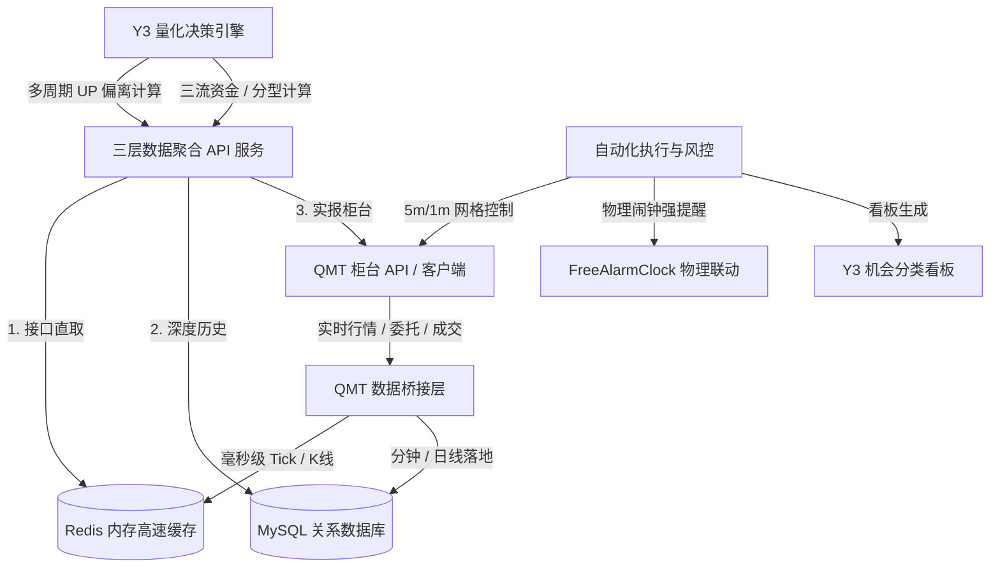

# Y3TRADE 量化交易与三层数据架构系统设计（脱敏版）

> **作者/架构师**：QuantDev / AI Full-Stack Team  
> **版本**：v3.5 (Production Ready)  
> **适用场景**：A 股中短线策略执行、做 T 网格控制、多周期共振风控与智能化盘中盯盘系统

---

## 一、 系统架构总览

Y3TRADE 是一套面向 A 股市场的智能化量化交易辅助与自动化风控系统。系统核心围绕 **UP 值偏离度算法**、**多周期共振（1d/1h/5m/1m）**、**网格降本控制** 以及 **极简去精力化防守纪律** 展开，具备物理层风控与柜台直报闭环能力。

### 系统数据与执行三层流转图



---

## 二、 核心技术亮点与设计思想

### 1. 数据存取三层优先级（High Availability Data Layer）
系统在数据读取层建立了严格的优先级降级链路，确保交易时段高并发与高可用：
- **第一优先级（API 直取）**：聚合服务直连，实时提供持仓全维度数据（MA34 偏离、持仓天数、买卖均价、背离值）。
- **第二优先级（Redis 内存直取）**：`tick:latest` 内存映射（涵盖全市场 49,000+ 标的实时报价），确保 0 延迟响应。
- **第三优先级（SQL 数据库）**：主要用于历史 K 线（a1d/a1h/a5m）归档及多周期回测计算。

```python
# 示例：脱敏数据路由逻辑
class DataRouter:
    def __init__(self, redis_client, db_pool, qmt_bridge):
        self.redis = redis_client
        self.db = db_pool
        self.qmt = qmt_bridge

    def get_realtime_quote(self, stock_code: str):
        # 1. 优先尝试从 Redis 内存 Hash 直取
        tick = self.redis.hget("tick:latest", stock_code)
        if tick:
            return parse_tick(tick)
        
        # 2. 内存缺失时降级从 QMT 柜台 API 抓取
        quote = self.qmt.get_full_tick([stock_code])
        if quote:
            return quote
            
        # 3. 兜底从数据库读取最新记录
        return self.db.query_latest_kline(stock_code)
```

---

### 2. UP 值多周期共振体系（Multi-Cycle Resonance Engine）
UP 值是系统的核心自研动能偏离指标，用于衡量股价偏离均线与动能衰竭的极值程度。

$$ \text{UP} = f(\text{Price}, \text{MA34}, \text{Volume}, \text{Volatility}) $$

- **周期分工**：
  - `1d`（日线）：决定仓位性质（核心仓 / 卫星仓）与趋势买卖点。
  - `1h`（小时线）：波段底反确立与阻力位判断。
  - `5m / 1m`（分钟线）：做 T 脉冲择时。卖出高抛依赖 **1m** 脉冲，自动回接平仓依赖 **5m** 下限。
- **共振状态计算**：
  将多周期 UP 信号与分型进行权重赋分（`强多` / `顺大回小` / `偏多` / `强势回踩` / `偏空` / `强空`）。
  *当标的处于【强空/偏空】时，系统红线禁止任何正 T 先买行为，仅允许做反 T 高抛。*

---

### 3. 做 T 网格与四重拦截算法（Grid Control & 4-Stage Interceptor）

为了防止盲目加仓与深套，系统在任何买入或建仓决策前实施 **四重拦截校验**：

```
[买入请求] 
   │
   ├── 1. 中观板块强流速约束 ──► 所属行业须处于【主升浪】或【潜伏期】(非极寒)
   │
   ├── 2. 大票优选流动性门槛 ──► 昨成交额排名前 300 且综合跑分 ≥ 6
   │
   ├── 3. 1d 二买形态验证   ──► 1d UP 勾头或回踩不破前低
   │
   └── 4. 1h 右侧底反确立   ──► 1h 级别形成右侧止跌底反
```

---

### 4. 物理层防错与硬性闹钟联动（Physical-Layer Fault Tolerance）
为防止人工操作遗漏（如临近到期期权单、因地缘突发事件需在 09:15 前强行撤单），系统引入了物理层强提醒机制。当检测到特定临界事件时，后台脚本自动调用 Windows/Mac 本地底层服务，拉起物理闹钟与声光提醒：

```python
# 物理层闹钟联动示例
def trigger_physical_alarm(event_time: str, label: str):
    """
    静默往本地闹钟软件写入任务，实现硬性防错
    """
    cmd = [
        "python3", "scripts/add_windows_alarm.py",
        "--time", event_time,
        "--label", f"【Y3风控警示】{label}"
    ]
    subprocess.run(cmd, check=True)
    print(f"🔔 [已联动物理闹钟] 已向本地写入 {event_time} - {label}")
```

---

## 三、 实战安全与风控纪律（Risk Controls）

1. **持仓只数硬性防线**：普通账户活跃股票持仓总数严格封顶于 **12 只** 以内。超过 12 只自动触发红色警示并输出清退优先级。
2. **策略现金比例约束**：
   $$ \text{策略现金比例} = \frac{\text{可用现金} + \text{GC001国债逆回购市值}}{\text{账户总资产}} \ge 65\% $$
   时刻保持充沛的战略现金弹药，拒绝满仓硬扛。
3. **期权买方冰点纪律**：期权单边对冲买入仅在权利金单价处于 **30 ~ 50 元/张 (0.0030 ~ 0.0050)** 的极低冰点时买入，买定离手，不占用日内精力。

---

## 四、 总结与工程哲学

Y3TRADE 系统的设计哲学是 **“中庸之道与知行合一”**：通过自动化规则磨平微观做 T 容错率，用中观趋势与强风控拦截磨灭情绪化冲动，从而实现低心智负担、可持续的量化交易管理。

*(注：本系统文档已做全局数据、凭据与敏感地址脱敏处理，仅供架构设计展示)*
