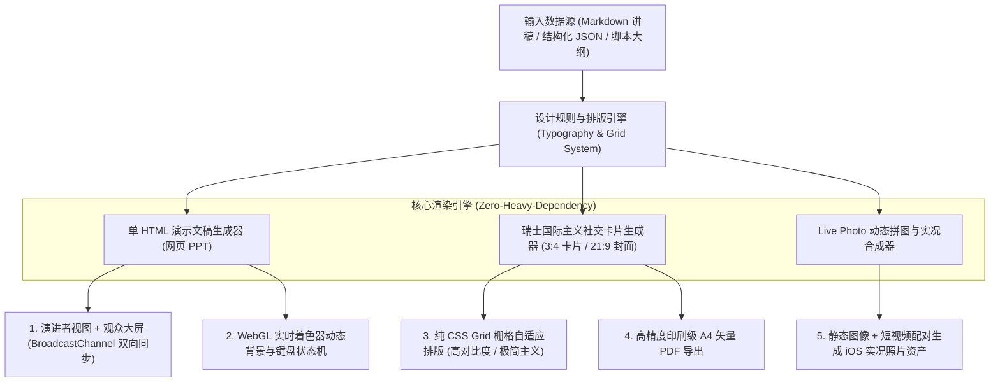

# 基于现代 Web 技术的参数化 PPT 与瑞士国际主义风格社交卡片生成引擎（脱敏版）

> **作者/架构师**：AI Full-Stack / Creative Technologist Team  
> **版本**：v2.0 (Production Ready)  
> **适用场景**：极客演示文稿、现代网页 PPT（单 HTML 自包含）、全自动小红书图文与 Live Photo 实况照片排版、新媒体设计工程化

---

## 一、 系统架构总览

传统演示文稿制作（PowerPoint、Keynote）与新媒体视觉排版（Figma、Canva、PS）长期依赖重型客户端与大量重复低效的手工排版操作。当需要批量生成高质感、风格高度统一的演示页面或社交媒体卡片时，手工操作不仅耗时冗长，而且难以与后端数据、动态脚本和 AI 内容流水线自动化整合。

本项目创新性地提出**“设计即代码（Design as Code）”**理念，通过现代 Web 技术（原生 JavaScript、HTML5 Canvas、WebGL 着色器与 CSS Grid/Flexbox），打造了一套**完全由代码驱动的跨端演示文稿与社交视觉卡片生成引擎**。

系统涵盖两大核心子系统：
1. **单文件自包含横向翻页网页 PPT 引擎**：支持 WebGL 流体/点阵背景、双屏广播同步（演讲者视图/讲稿备注与观众展示大屏解耦同步）；
2. **瑞士国际主义风格新媒体排版引擎**：将高级排版审美规则化、参数化，纯代码自动化输出小红书 3:4 卡片、微信 21:9 封面配对以及 Live Photo 实况照片交互拼图。

### 自动化生成引擎架构图



---

## 二、 核心技术亮点与设计思想

### 1. 无框架依赖单文件网页 PPT 与双屏广播同步架构 (Dual-Screen Broadcast Sync)
传统网页 PPT 往往依赖庞大的 Node.js 前端构建流和第三方库。本引擎生成的 PPT 为 **100% 独立的单 HTML 文件**，内嵌所有样式与逻辑，无需本地服务器即可双击打开：
- **广播通信频道（BroadcastChannel API）**：无需任何 WebSocket 后端服务，仅通过浏览器原生 `BroadcastChannel` 即可在“主屏幕（仅展示纯净幻灯片）”与“演讲者副屏（展示当前页、下一页预览、倒计时、详细讲稿备忘）”之间毫秒级精准同步页码和翻页状态；
- **全键盘与触控手势状态机**：完整支持左右方向键、空格翻页、全屏切换（F 键）以及移动端横向滑动过渡。

```javascript
// 核心脱敏实现：基于原生 BroadcastChannel 的双屏演讲者同步引擎
class PresentationController {
  constructor(totalPages = 10) {
    this.currentPage = 1;
    this.totalPages = totalPages;
    // 建立跨浏览器 Tab / 跨屏幕的原生广播通道
    this.channel = new BroadcastChannel('presentation_sync_bus');
    this.initListeners();
  }

  initListeners() {
    // 监听键盘切换
    window.addEventListener('keydown', (e) => {
      if (['ArrowRight', 'Space', 'PageDown'].includes(e.code)) {
        this.nextSlide();
      } else if (['ArrowLeft', 'PageUp'].includes(e.code)) {
        this.prevSlide();
      } else if (e.key.toLowerCase() === 'p') {
        this.openPresenterWindow();
      }
    });

    // 接收来自演讲者视图的远程跳页指令
    this.channel.onmessage = (event) => {
      const { type, page } = event.data;
      if (type === 'GOTO_SLIDE' && page !== this.currentPage) {
        this.renderSlide(page, false);
      }
    };
  }

  renderSlide(pageNumber, shouldBroadcast = true) {
    this.currentPage = Math.max(1, Math.min(pageNumber, this.totalPages));
    document.querySelectorAll('.slide').forEach((slide, idx) => {
      slide.classList.toggle('active', idx + 1 === this.currentPage);
    });

    if (shouldBroadcast) {
      this.channel.postMessage({ type: 'GOTO_SLIDE', page: this.currentPage });
    }
  }

  nextSlide() { this.renderSlide(this.currentPage + 1); }
  prevSlide() { this.renderSlide(this.currentPage - 1); }

  openPresenterWindow() {
    // 一键弹出独立的演讲者备忘控制台
    window.open('presenter_view.html', '_blank', 'width=1024,height=768');
  }
}
```

---

### 2. 瑞士国际主义排版模型与参数化卡片生成 (Swiss Style Typography Grid)
针对社媒平台（小红书、微信公众号、技术博客）的图片制作，系统将世界著名的“瑞士平面设计（Swiss International Typographic Style）”法则编写成纯 CSS 与 HTML 模板：
- **数学化网格点阵**：背景支持高质感细点阵或几何网格线条，提供极高的工程理性美感；
- **排版层级铁律**：严守“大字号粗黑体标题（如 64px+ 无衬线体）+ 极简副标 + 醒目序号印章 + 模块化数据大字报”排版逻辑；
- **主题高亮色自适应**：预设“瑞士安全橙（Safety Orange）”、“克莱因蓝（IKB）”、“荧光柠檬黄”与“极客深暗墨水”，通过 CSS 自定义变量实现全套卡片 1 秒一键换肤。

```html
<!-- 核心脱敏实现：瑞士风格标准 3:4 社媒卡片排版核心结构 -->
<div class="card-container">
  <!-- 顶部状态栏与序号印章 -->
  <div class="card-header">
    <span class="badge">SYSTEM ARCHITECTURE</span>
    <span class="index-num">01 / 06</span>
  </div>

  <!-- 主标题与核心论点 -->
  <div class="content-box">
    <h1 class="main-title">中庸之道<br><span class="accent-text">与量化网格风控</span></h1>
    <p class="summary-text">彻底告别过度宏观恐惧与微观强迫症，以 34 日生命线构建全天候战略底座。</p>
  </div>

  <!-- 数据大字报区块 -->
  <div class="metric-grid">
    <div class="metric-card">
      <div class="metric-value">≥50%</div>
      <div class="metric-label">策略现金平衡储备</div>
    </div>
    <div class="metric-card">
      <div class="metric-value">&lt;1ms</div>
      <div class="metric-label">Redis 内存检索时延</div>
    </div>
  </div>

  <!-- 底部签名与版权 -->
  <div class="card-footer">
    <span>AI FULL-STACK LAB</span>
    <span>RELEASE: 2026-Q4</span>
  </div>
</div>
```

---

### 3. Live Photo 实况照片与新媒体动态拼图流水线
- **实况照片资产配对**：将高质量静态 JPEG/HEIC 图片与短视频片段通过 Asset Identifier 深度绑定，自动生成可以在 iOS 设备上长按播放的 Live Photo 实况照片；
- **长视频一键切片拼图**：提供二宫格、三连实况、四宫格拼图布局算法，自动计算裁切比例与安全区域，保证视觉重心绝不被社媒平台 UI 遮挡。

---

## 三、 核心应用场景与工程成效

| 场景维度 | 传统设计与演示方式 | 本引擎生成落地 | 实际提效收益 |
| :--- | :--- | :--- | :--- |
| **技术路演/大会分享** | PPT 文件体积大、依赖字体库、换电脑易排版错乱 | 单 HTML 自包含文件，带 WebGL 背景与双屏演讲者视图 | 零依赖即开即播，演讲者备忘与观众大屏独立同步 |
| **小红书/公众号图文** | 设计师在 Figma/Canva 中手动调字号、对齐、导图 | 传入结构化 Markdown，Python/Node 自动一键导出整套高清卡片 | 出图速度从单篇 2 小时缩短至 2 分钟，风格高度一致 |
| **复杂工程知识路线图** | 传统流程图软件导出模糊、难以适配打印印刷 | CSS Grid 响应式矢量排版，支持高清无损 A4 纸张矢量打印 | 达到专业出版社出版级别的排版规整度与印刷分辨率 |

---

*(注：本文档中代码均为纯自研前端排版逻辑与开源 API 组合，不包含任何商业字体文件版权或具体私有文案内容)*
