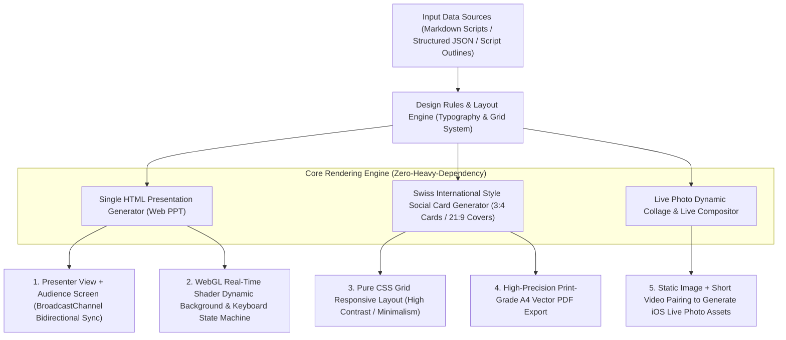

> **[ 🌐 English Version | 🇨🇳 [中文文档 (Chinese Version)](./17_parametric_web_slides_swiss_social_cards_zh.md) ]**

# Parametric PPT and Swiss International Style Social Card Generation Engine Built on Modern Web Technologies (Sanitized Version)

> **Author/Architect**: AI Full-Stack / Creative Technologist Team  
> **Version**: v2.0 (Production Ready)  
> **Applicable Scenarios**: Geek presentation decks, modern web-based PPT (single self-contained HTML), fully automated Xiaohongshu image-text and Live Photo layout, new media design engineering

---

## I. System Architecture Overview

Traditional presentation creation (PowerPoint, Keynote) and new media visual layout (Figma, Canva, PS) have long relied on heavyweight clients and a large volume of repetitive, inefficient manual layout operations. When high-quality, highly stylistically consistent presentation pages or social media cards need to be generated in bulk, manual operations are not only time-consuming and tedious but also difficult to integrate automatically with backend data, dynamic scripts, and AI content pipelines.

This project innovatively proposes the **"Design as Code"** philosophy, leveraging modern web technologies (vanilla JavaScript, HTML5 Canvas, WebGL shaders, and CSS Grid/Flexbox) to build a **fully code-driven cross-platform presentation and social visual card generation engine**.

The system encompasses two core subsystems:
1. **Single-file self-contained horizontal-paging web PPT engine**: Supports WebGL fluid/dot-matrix backgrounds and dual-screen broadcast synchronization (decoupled synchronization between presenter view/speaker notes and audience display screen);
2. **Swiss International Style new media layout engine**: Codifies and parameterizes high-end typographic aesthetic rules, automatically outputting Xiaohongshu 3:4 cards, WeChat 21:9 cover pairings, and Live Photo interactive collages purely through code.

### Automated Generation Engine Architecture Diagram



---

## II. Core Technical Highlights and Design Philosophy

### 1. Framework-Free Single-File Web PPT with Dual-Screen Broadcast Sync Architecture
Traditional web-based PPTs often depend on massive Node.js frontend build pipelines and third-party libraries. The PPT generated by this engine is a **100% standalone single HTML file** with all styles and logic embedded, requiring no local server—just double-click to open:
- **Broadcast Communication Channel (BroadcastChannel API)**: No WebSocket backend service required whatsoever; using only the browser-native `BroadcastChannel`, millisecond-precision synchronization of page numbers and navigation state is achieved between the "main screen (displaying only clean slides)" and the "presenter secondary screen (showing current page, next-page preview, countdown timer, and detailed speaker notes)";
- **Full Keyboard and Touch Gesture State Machine**: Complete support for left/right arrow keys, spacebar paging, fullscreen toggle (F key), and mobile horizontal swipe transitions.

```javascript
// Core sanitized implementation: Native BroadcastChannel-based dual-screen presenter sync engine
class PresentationController {
  constructor(totalPages = 10) {
    this.currentPage = 1;
    this.totalPages = totalPages;
    // Establish cross-browser-tab / cross-screen native broadcast channel
    this.channel = new BroadcastChannel('presentation_sync_bus');
    this.initListeners();
  }

  initListeners() {
    // Listen for keyboard navigation
    window.addEventListener('keydown', (e) => {
      if (['ArrowRight', 'Space', 'PageDown'].includes(e.code)) {
        this.nextSlide();
      } else if (['ArrowLeft', 'PageUp'].includes(e.code)) {
        this.prevSlide();
      } else if (e.key.toLowerCase() === 'p') {
        this.openPresenterWindow();
      }
    });

    // Receive remote page-jump commands from presenter view
    this.channel.onmessage = (event) => {
      const { type, page } = event.data;
      if (type === 'GOTO_SLIDE' && page !== this.currentPage) {
        this.renderSlide(page, false);
      }
    };
  }

  renderSlide(pageNumber, shouldBroadcast = true) {
    this.currentPage = Math.max(1, Math.min(pageNumber, this.totalPages));
    document.querySelectorAll('.slide').forEach((slide, idx) => {
      slide.classList.toggle('active', idx + 1 === this.currentPage);
    });

    if (shouldBroadcast) {
      this.channel.postMessage({ type: 'GOTO_SLIDE', page: this.currentPage });
    }
  }

  nextSlide() { this.renderSlide(this.currentPage + 1); }
  prevSlide() { this.renderSlide(this.currentPage - 1); }

  openPresenterWindow() {
    // One-click popup of independent presenter notes console
    window.open('presenter_view.html', '_blank', 'width=1024,height=768');
  }
}
```

---

### 2. Swiss International Style Typography Model and Parametric Card Generation
For image production on social media platforms (Xiaohongshu, WeChat Official Accounts, tech blogs), the system codifies the world-renowned "Swiss International Typographic Style" principles into pure CSS and HTML templates:
- **Mathematical Grid Dot Matrix**: Backgrounds support high-quality fine dot matrices or geometric grid lines, delivering an exceptional sense of engineering rationality and aesthetic precision;
- **Typographic Hierarchy Iron Rules**: Strictly adheres to the layout logic of "large bold sans-serif headline (e.g., 64px+ sans-serif) + minimalist subtitle + prominent index stamp + modular data display cards";
- **Theme Accent Color Adaptation**: Presets include "Safety Orange," "International Klein Blue (IKB)," "Fluorescent Lemon Yellow," and "Geek Deep Dark Ink," with full card set theme switching in 1 second via CSS custom properties.

```html
<!-- Core sanitized implementation: Swiss-style standard 3:4 social media card layout core structure -->
<div class="card-container">
  <!-- Top status bar and index stamp -->
  <div class="card-header">
    <span class="badge">SYSTEM ARCHITECTURE</span>
    <span class="index-num">01 / 06</span>
  </div>

  <!-- Main title and core thesis -->
  <div class="content-box">
    <h1 class="main-title">The Doctrine of the Mean<br><span class="accent-text">and Quantitative Grid Risk Control</span></h1>
    <p class="summary-text">Completely abandon excessive macro-fear and micro-obsession; build an all-weather strategic foundation on the 34-day lifeline.</p>
  </div>

  <!-- Data display card blocks -->
  <div class="metric-grid">
    <div class="metric-card">
      <div class="metric-value">≥50%</div>
      <div class="metric-label">Strategic Cash Balance Reserve</div>
    </div>
    <div class="metric-card">
      <div class="metric-value">&lt;1ms</div>
      <div class="metric-label">Redis In-Memory Retrieval Latency</div>
    </div>
  </div>

  <!-- Bottom signature and copyright -->
  <div class="card-footer">
    <span>AI FULL-STACK LAB</span>
    <span>RELEASE: 2026-Q4</span>
  </div>
</div>
```

---

### 3. Live Photo and New Media Dynamic Collage Pipeline
- **Live Photo Asset Pairing**: Deep-binds high-quality static JPEG/HEIC images with short video clips via Asset Identifier, automatically generating Live Photos that can be played via long-press on iOS devices;
- **One-Click Long Video Slicing and Collage**: Provides two-grid, triple Live Photo, and four-grid collage layout algorithms, automatically calculating crop ratios and safe zones to ensure the visual focal point is never obscured by social media platform UI.

---

## III. Core Application Scenarios and Engineering Results

| Scenario Dimension | Traditional Design & Presentation Approach | Engine-Generated Output | Actual Efficiency Gains |
| :--- | :--- | :--- | :--- |
| **Tech Roadshows / Conference Talks** | Large PPT file sizes, font library dependencies, layout corruption when switching computers | Single self-contained HTML file with WebGL backgrounds and dual-screen presenter view | Zero-dependency, instant playback; presenter notes and audience screen independently synchronized |
| **Xiaohongshu / WeChat Official Account Graphics** | Designers manually adjusting font sizes, alignment, and exporting images in Figma/Canva | Pass in structured Markdown; Python/Node automatically exports full set of HD cards in one click | Image production time reduced from 2 hours per piece to 2 minutes, with highly consistent styling |
| **Complex Engineering Knowledge Roadmaps** | Traditional flowchart software exports blurry, difficult to adapt for print | CSS Grid responsive vector layout, supporting HD lossless A4 paper vector printing | Achieves professional publishing-house-grade layout regularity and print resolution |

---

*(Note: All code in this document is purely self-developed frontend layout logic combined with open-source APIs, and contains no commercial font file copyrights or specific proprietary copy content)*
