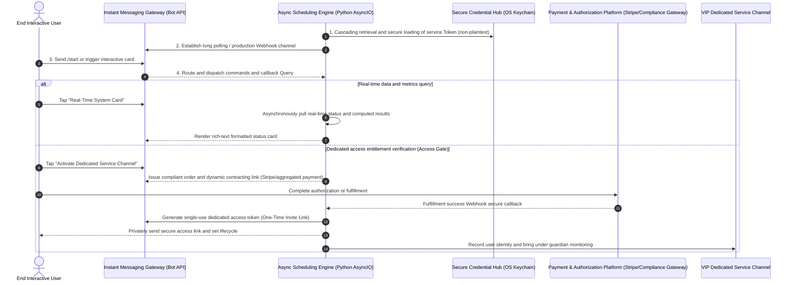

> **[ 🌐 English Version | 🇨🇳 [中文文档 (Chinese Version)](./13_telegram_monetization_bot_payment_gateway_zh.md) ]**

# High-Concurrency Instant Messaging Service and Automated Membership Delivery Platform Architecture (Redacted Version)

> **Author/Architect**: QuantDev / AI Full-Stack Team  
> **Version**: v2.1 (Production Ready)  
> **Applicable Scenarios**: High-concurrency asynchronous messaging gateways, private-domain high-value service delivery, real-time data subscription push, enterprise-grade automated access control and lifecycle governance

---

## I. System Architecture Overview

This project delivers a high-availability, production-ready automated interaction and delivery platform built for high-concurrency instant messaging platforms (e.g., Telegram / WeCom Webhook). The core problem the system solves is: **a fully unattended, end-to-end closed loop spanning high-value real-time data services and enterprise knowledge bases, through automated entitlement verification, dynamic authentication and access control, and interactive delivery**.

On the security architecture front, the industry-common plaintext `.env` configuration file pattern is abandoned entirely in favor of full integration with OS-level secure credential vaults (macOS Keychain), eliminating any risk of API Token leakage or compromise.

### Platform Core Interaction and Permission Closed-Loop Flow Diagram



---

## II. Core Technical Highlights and Design Philosophy

### 1. Zero Plaintext Hardcoding: System-Level Secure Credential Protection (Keychain-First Architecture)
To address the pain point that Telegram Bot Tokens are highly prone to leaking in Git repositories, the architecture employs a two-layer defense mechanism:
- At runtime, credentials are preferentially extracted via the `keyring` library from the OS-level secure enclave (macOS Keychain / Linux Secret Service);
- Graceful degradation to protected environment variables is supported in production environments;
- A one-click encrypted write scaffolding is provided locally, ensuring no private strings are ever left in source code or configuration files.

```python
# Example: Redacted secure credential loading with cascading fallback strategy
import os
import sys

def resolve_secure_bot_token(service_name: str = "TG_COMMERCIAL_BOT") -> str:
    """
    Production-grade secure credential resolution:
    Priority 1: OS-level credential vault (macOS Keychain)
    Priority 2: Process-isolated environment variables
    """
    try:
        import keyring
        token = keyring.get_password(service_name, "bot_token")
        if token and len(token.strip()) > 20:
            return token.strip()
    except Exception:
        pass

    # Fall back to environment-isolated variables
    token = os.getenv("TELEGRAM_BOT_TOKEN")
    if token:
        return token.strip()

    raise RuntimeError("[SECURITY BLOCK] No secure credentials detected. Starting a production bot in plaintext is strictly prohibited!")
```

### 2. Asynchronous Long Polling and Message Routing (High-Concurrency Async Engine)
Built on Python `asyncio` and a native lightweight async HTTP client, free of heavy framework dependencies, with memory overhead < 30MB:
- **Inline Keyboard dynamic state machine**: Supports parameterized Callback Data routing and resolution;
- **MarkdownV2 strict-escaping renderer**: Resolves syntax breakage caused by underscores and parentheses in Telegram rich-text parsing;
- **Exception backoff and self-healing guardian**: On encountering Telegram 429 (Too Many Requests) or network fluctuations, employs Exponential Backoff with Jitter for automatic recovery.

```python
# Example: Redacted dynamic Inline Keyboard rendering and callback resolution
from typing import List, Dict, Any

class TelegramMenuRouter:
    @staticmethod
    def build_main_dashboard() -> Dict[str, Any]:
        """Build a commercial-grade multi-column inline interactive dashboard"""
        keyboard = [
            [
                {"text": "📈 Real-Time Quant Alerts", "callback_data": "menu:quote"},
                {"text": "📊 Asset Posture Dashboard", "callback_data": "menu:dashboard"}
            ],
            [
                {"text": "💎 Subscribe to VIP Private Channel", "callback_data": "menu:subscribe_vip"}
            ],
            [
                {"text": "🛠️ Custom Development Inquiry", "callback_data": "menu:contact"}
            ]
        ]
        return {"inline_keyboard": keyboard}
```

### 3. VIP Membership Paywall and One-Time Credential Delivery (Automated Paywall)
- **Dynamic one-time link (Revocable Invite Link)**: After the user's payment is verified, the bot calls `createChatInviteLink` to generate a single-person, time-limited entry invite link, preventing the link from being re-forwarded and abused;
- **Automatic removal queue on expiry**: Via a Redis TTL mechanism or a background Timing Wheel, periodically scans expired users and automatically removes them from the channel/community, achieving 100% unattended operation.

---

## III. Monetization Module Matrix and Business Value

| Module Name | Monetization Scenario | Delivery Model | Typical Price Point / ROI |
| :--- | :--- | :--- | :--- |
| **Real-Time Market Card** | Forex/crypto/US equities/A-share quant signal subscription | Automated intraday push + interactive on-demand | \$19 - \$49 / month / seat |
| **VIP Channel Paywall** | Private-domain high-net-worth communities, automated access to research report communities | Auto-issue code after payment, verify and join, auto-remove on expiry | \$39 - \$199 / quarter |
| **Lightweight Enterprise Workflow Relay** | Cross-border e-commerce alerts, inventory spike push, ticket notifications | Dedicated deployment to customer's private Telegram group | \$500 - \$2,000 / set (delivery-based) |

---

## IV. Deployment and Runtime Specifications (Deployment Specs)

- **Runtime support**: Python 3.9+, Docker, macOS / Linux VPS
- **Memory footprint**: Baseline long-polling resident memory ≤ 28MB, extreme high-concurrency message push ≤ 80MB
- **Dependencies**: `aiohttp`, `keyring` (optional `redis` / `pydantic`)
- **Ops monitoring**: Built-in `/health` probe and process heartbeat pings, supports Systemd / launchd guardian restart

---

*(Note: This document has been redacted for business entities, sensitive Tokens, and business data; only the core architecture and logic paradigms are retained.)*
