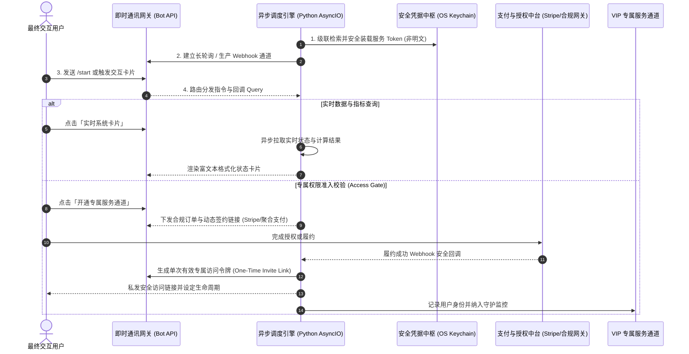

# 高并发即时通讯服务与自动化会员交付中台架构（脱敏版）

> **作者/架构师**：QuantDev / AI Full-Stack Team  
> **版本**：v2.1 (Production Ready)  
> **适用场景**：高并发异步消息网关、私域高价值服务交付、实时数据订阅推送、企业级自动化准入与生命周期治理

---

## 一、 系统架构总览

本项目提供了一套面向高并发即时通讯平台（如 Telegram / 企微 Webhook）的高可用、生产就绪型自动化交互与交付中台。系统解决的核心问题是：**从高价值实时数据服务与企业知识库，到自动化权益校验、动态鉴权准入与交互交付的全链路无人值守闭环**。

在安全架构上，彻底抛弃业内常见的明文 `.env` 配置文件模式，全面接入操作系统级安全凭据保管库（macOS Keychain），杜绝任何 API Token 泄漏与被攻击风险。

### 中台核心交互与权限闭环流转图



---

## 二、 核心技术亮点与设计思想

### 1. 零明文硬编码：系统级安全凭据防护 (Keychain-First Architecture)
针对 Telegram Bot Token 极易在 Git 仓库泄漏的痛点，架构设计了双层防御机制：
- 运行时优先通过 `keyring` 库从操作系统底层安全区（macOS Keychain / Linux Secret Service）提取凭据；
- 支持生产环境优雅降级至受保护的环境变量；
- 本地提供一键加密写入脚手架，杜绝在源码或配置文件中留下任何私密字符串。

```python
# 示例：脱敏后的安全凭据装载与级联降级策略
import os
import sys

def resolve_secure_bot_token(service_name: str = "TG_COMMERCIAL_BOT") -> str:
    """
    生产级安全凭据解算：
    优先级 1: 操作系统底层凭据保险箱 (macOS Keychain)
    优先级 2: 进程隔离环境变量
    """
    try:
        import keyring
        token = keyring.get_password(service_name, "bot_token")
        if token and len(token.strip()) > 20:
            return token.strip()
    except Exception:
        pass

    # 降级至环境隔离变量
    token = os.getenv("TELEGRAM_BOT_TOKEN")
    if token:
        return token.strip()

    raise RuntimeError("【安全阻断】未检测到安全凭据，严禁以明文方式启动生产机器人！")
```

### 2. 异步长轮询与消息路由（High-Concurrency Async Engine）
基于 Python `asyncio` 与原生轻量异步 HTTP 客户端构建，摆脱重型框架依赖，内存开销 < 30MB：
- **Inline Keyboard（内嵌键盘）动态状态机**：支持带参数的 Callback Data 路由解算；
- **MarkdownV2 强转义渲染器**：解决 Telegram 富文本解析中下划线、括号导致的语法熔断问题；
- **异常退避与自愈守护**：遇到 Telegram 429（Too Many Requests）或网络波动时，采用带抖动的指数退避（Exponential Backoff with Jitter）自动恢复。

```python
# 示例：脱敏后的动态 Inline Keyboard 渲染与回调解算
from typing import List, Dict, Any

class TelegramMenuRouter:
    @staticmethod
    def build_main_dashboard() -> Dict[str, Any]:
        """构建商业级多列内嵌交互仪表盘"""
        keyboard = [
            [
                {"text": "📈 实时量化异动", "callback_data": "menu:quote"},
                {"text": "📊 资产态势大屏", "callback_data": "menu:dashboard"}
            ],
            [
                {"text": "💎 订阅 VIP 私密频道", "callback_data": "menu:subscribe_vip"}
            ],
            [
                {"text": "🛠️ 定制开发咨询", "callback_data": "menu:contact"}
            ]
        ]
        return {"inline_keyboard": keyboard}
```

### 3. VIP 会员付费拦截与一次性凭据交付（Automated Paywall）
- **动态一次性链接 (Revocable Invite Link)**：用户支付核销后，机器人调用 `createChatInviteLink` 生成单人有效、限时入场的邀请链接，防止链接被二次转发滥用；
- **到期自动移出队列**：通过 Redis TTL 机制或后台时间轮（Timing Wheel），定期扫描到期用户并自动从频道/社群中移除，实现 100% 无人值守运作。

---

## 三、 商业变现模块矩阵与落地价值

| 模块名称 | 变现场景 | 交付模式 | 典型客单价/ROI |
| :--- | :--- | :--- | :--- |
| **实时行情卡片** | 外汇/加密货币/美股/A股量化信号订阅 | 每日盘中自动推送 + 交互式点播 | \$19 - \$49 / 月 / 席位 |
| **VIP 频道付费墙** | 私域高净值社区、研报社群自动准入 | 支付后自动发码、核销入群、逾期自动移出 | \$39 - \$199 / 季度 |
| **轻量企业工作流中继** | 跨境电商报警、库存突变推送、工单通知 | 专有部署至客户私有 Telegram 群组 | \$500 - \$2,000 / 套 (交付制) |

---

## 四、 部署与运行规格 (Deployment Specs)

- **运行时支持**：Python 3.9+、Docker、macOS / Linux VPS
- **内存占用**：基础长轮询驻留内存 ≤ 28MB，极端高并发消息推送 ≤ 80MB
- **依赖库**：`aiohttp`, `keyring` (可选 `redis` / `pydantic`)
- **运维监控**：内置 `/health` 探针与进程心跳打点，支持 Systemd / launchd 守护重启

---

*(注：本文档已执行商业主体、敏感 Token 及业务数据脱敏，仅保留核心架构与逻辑范式)*
