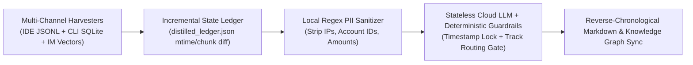

# Multi-Channel Agentic Session Distillation & Incremental Memory Ledger (Redacted Version)

> **Author/Architect**: CK Yan (@cky9)  
> **Version**: v2.0 (Cloud-Stateless Ledger Edition)  
> **Applicable Scenarios**: Autonomous engineering runbook generation, cross-IDE/CLI agent memory consolidation, privacy-preserving LLM knowledge distillation

---

## I. Problem Statement: Fragmented Tribal Knowledge Across AI Modalities

Modern engineers interact with multiple AI environments daily—IDE coding agents (`transcript.jsonl`), terminal CLI agents (`SQLite` thread stores), and mobile chat copilots (`Vector SQLite`). High-value debugging insights and architectural contracts are frequently buried in raw chat logs:
- **Full-Text Sync Fallacy**: Dumping raw chat logs into a note app creates megabytes of low-signal noise;
- **Resource & Hallucination Risks**: Running heavy local LLMs consumes valuable RAM/Swap, while lightweight cloud models can hallucinate dates or misclassify domain tracks without deterministic guardrails.

---

## II. Four-Stage Autonomous Distillation Pipeline

1. **Incremental State Ledger (`distilled_ledger.json`)**:
   - Tracks `mtime` and `chunk_count` per conversation ID across all channels, ensuring each session version is distilled **at most once** with zero missed historical sessions.
2. **Pre-Flight Local PII/Secret Sanitization**:
   - Automatically scrubs RFC1918 LAN IPs (`<LOCAL_IP>`), account numbers (`<ACCOUNT_ID>`), and financial figures (`<AMOUNT>`) via regex **before** any payload leaves localhost.
3. **Deterministic Timestamp Lock & Multi-Track Semantic Routing**:
   - Overrides LLM-generated dates with the physical file modification timestamp and enforces keyword-based track routing (`[System Engineering]` vs `[Business Operations]` vs `[Domain Discipline]`).
