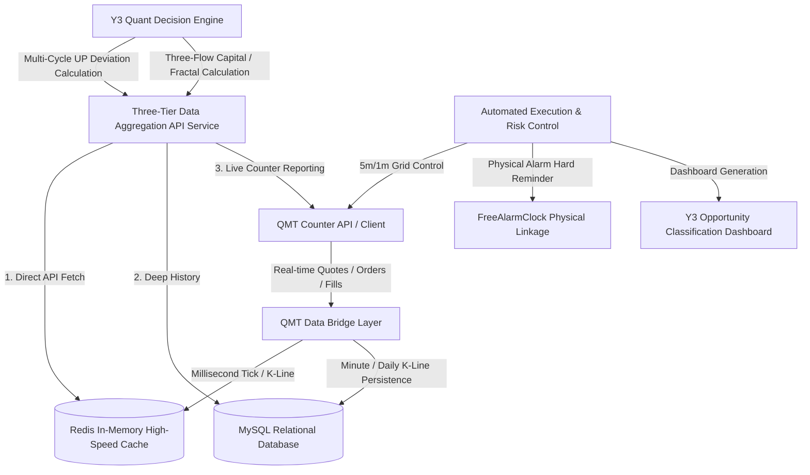

> **[ 🌐 English Version | 🇨🇳 [中文文档 (Chinese Version)](./01_three_tier_quant_trading_architecture_zh.md) ]**

# Y3TRADE Quantitative Trading and Three-Tier Data Architecture System Design (Redacted Version)

> **Author/Architect**: QuantDev / AI Full-Stack Team  
> **Version**: v3.5 (Production Ready)  
> **Applicable Scenarios**: A-share medium-to-short-term strategy execution, T-trading grid control, multi-cycle resonance risk control, and intelligent intraday monitoring system

---

## I. System Architecture Overview

Y3TRADE is an intelligent quantitative trading assistance and automated risk control system built for the A-share market. The system is centered around the **UP Value Deviation Algorithm**, **Multi-Cycle Resonance (1d/1h/5m/1m)**, **Grid Cost-Reduction Control**, and **Minimalist, Low-Cognitive-Load Defensive Discipline**, with physical-layer risk control and direct-to-counter order routing closed-loop capabilities.

### System Data and Execution Three-Tier Flow Diagram



---

## II. Core Technical Highlights and Design Philosophy

### 1. Three-Tier Data Access Priority (High Availability Data Layer)
The system establishes a strict priority-based degradation chain at the data read layer to ensure high concurrency and high availability during trading hours:
- **First Priority (Direct API Fetch)**: Aggregation service connects directly, providing real-time full-dimensional position data (MA34 deviation, holding days, average buy/sell price, divergence value).
- **Second Priority (Direct Redis In-Memory Fetch)**: `tick:latest` in-memory mapping (covering real-time quotes for 49,000+ instruments across the entire market), ensuring zero-latency response.
- **Third Priority (SQL Database)**: Primarily used for historical K-line (a1d/a1h/a5m) archival and multi-cycle backtesting computation.

```python
# Example: Redacted data routing logic
class DataRouter:
    def __init__(self, redis_client, db_pool, qmt_bridge):
        self.redis = redis_client
        self.db = db_pool
        self.qmt = qmt_bridge

    def get_realtime_quote(self, stock_code: str):
        # 1. Prioritize direct fetch from Redis in-memory Hash
        tick = self.redis.hget("tick:latest", stock_code)
        if tick:
            return parse_tick(tick)
        
        # 2. On cache miss, degrade to fetching from QMT counter API
        quote = self.qmt.get_full_tick([stock_code])
        if quote:
            return quote
            
        # 3. Fallback to reading the latest record from the database
        return self.db.query_latest_kline(stock_code)
```

---

### 2. UP Value Multi-Cycle Resonance Engine
UP Value is the system's core proprietary momentum deviation indicator, used to measure the extreme degree of price deviation from moving averages and momentum exhaustion.

$$ \text{UP} = f(\text{Price}, \text{MA34}, \text{Volume}, \text{Volatility}) $$

- **Cycle Division of Labor**:
  - `1d` (Daily): Determines position nature (core position / satellite position) and trend buy/sell points.
  - `1h` (Hourly): Swing bottom reversal confirmation and resistance level assessment.
  - `5m / 1m` (Minute): T-trading pulse timing. Sell-side high抛 depends on **1m** pulse; automatic re-entry closing depends on **5m** lower bound.
- **Resonance State Calculation**:
  Multi-cycle UP signals and fractals are weight-scored (`Strong Bull` / `Trend-Following Pullback` / `Lean Bull` / `Strong Pullback` / `Lean Bear` / `Strong Bear`).
  *When an instrument is in [Strong Bear / Lean Bear], the system red line prohibits any positive-T buy-first behavior, allowing only reverse-T high sells.*

---

### 3. T-Trading Grid and 4-Stage Interceptor Algorithm

To prevent blind position-adding and deep drawdowns, the system enforces a **Four-Stage Interceptor Validation** before any buy or position-building decision:

```
[Buy Request] 
   │
   ├── 1. Meso Sector Strong Flow Constraint ──► Sector must be in [Main Uptrend] or [Accumulation Phase] (not Extreme Cold)
   │
   ├── 2. Large-Cap Liquidity Preference Threshold ──► Prior-day turnover rank top 300 and composite score ≥ 6
   │
   ├── 3. 1d Second-Buy Pattern Validation   ──► 1d UP hook-up or pullback holding above prior low
   │
   └── 4. 1h Right-Side Bottom Reversal Confirmation   ──► 1h-level right-side bottoming reversal formed
```

---

### 4. Physical-Layer Fault Tolerance and Hard Alarm Linkage
To prevent manual operation omissions (e.g., near-expiry options orders, forced cancellation before 09:15 due to geopolitical events), the system introduces a physical-layer hard reminder mechanism. When a specific critical event is detected, the backend script automatically invokes Windows/Mac local low-level services to trigger physical alarms and audio-visual alerts:

```python
# Physical-layer alarm linkage example
def trigger_physical_alarm(event_time: str, label: str):
    """
    Silently write tasks to local alarm software for hard fault tolerance
    """
    cmd = [
        "python3", "scripts/add_windows_alarm.py",
        "--time", event_time,
        "--label", f"[Y3 Risk Control Alert] {label}"
    ]
    subprocess.run(cmd, check=True)
    print(f"🔔 [Physical Alarm Linked] Written to local: {event_time} - {label}")
```

---

## III. Live Trading Safety and Risk Control Discipline

1. **Hard Position Count Defense Line**: The total number of active stock holdings in a standard account is strictly capped at **12**. Exceeding 12 automatically triggers a red alert and outputs liquidation priority.
2. **Strategy Cash Ratio Constraint**:
   $$ \text{Strategy Cash Ratio} = \frac{\text{Available Cash} + \text{GC001 Treasury Reverse Repo Market Value}}{\text{Total Account Assets}} \ge 65\% $$
   Always maintain ample strategic cash ammunition; refuse to hold full positions and tough it out.
3. **Options Buyer Freezing-Point Discipline**: Options unilateral hedge buying is only permitted when the premium unit price is at an extremely low freezing point of **30 ~ 50 CNY/contract (0.0030 ~ 0.0050)**. Buy and leave it; do not occupy intraday energy.

---

## IV. Summary and Engineering Philosophy

The design philosophy of the Y3TRADE system is **"The Doctrine of the Mean and the Unity of Knowledge and Action"**: smoothing out micro-level T-trading error tolerance through automated rules, and extinguishing emotional impulses through meso-level trends and strong risk control interceptors, thereby achieving low cognitive load and sustainable quantitative trading management.

*(Note: This system document has undergone global redaction of data, credentials, and sensitive addresses; it is intended solely for architectural design demonstration.)*
