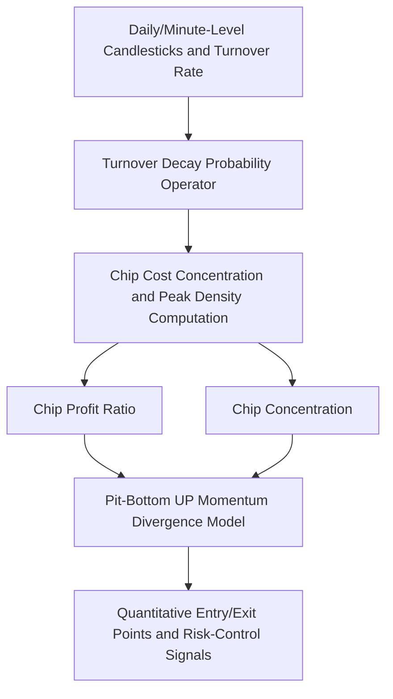

> **[ 🌐 English Version | 🇨🇳 [中文文档 (Chinese Version)](./06_chip_distribution_cost_density_model_zh.md) ]**

# Chip Distribution and Cost-Peak Density Quantitative Model (Sanitized Version)

> **Author/Quantitative Architect**: Quantitative Trading & Factor Engineering Team
> **Core Algorithms**: Turnover Decay Model · Cost-Chip Peak Density · Profit-Ratio Compute · Pit-Bottom UP Momentum Divergence Detection

---

## I. Model Background and Mathematical Principles

In equities and quantitative trading, chips distribution reflects the holding-cost structure of all market participants. The clustering and dispersion of chip peaks directly determine the strength of resistance and support levels.

This project builds a **"Dynamic Chip-Peak Density and Pit-Bottom UP Momentum Divergence"** quantitative factor model on top of daily turnover rates and a historical price decay function.



---

## II. Core Algorithms and Code Implementation

```python
# Sanitized algorithm illustration: chip distribution peak density computation
import numpy as np

def calculate_chip_distribution(prices, volumes, turnover_rates, bins=100):
    """
    Compute chip distribution based on historical turnover decay
    """
    price_min, price_max = np.min(prices), np.max(prices)
    price_bins = np.linspace(price_min, price_max, bins)
    chip_heap = np.zeros(bins)
    
    decay_factor = 1.0
    for price, volume, turnover in zip(reversed(prices), reversed(volumes), reversed(turnover_rates)):
        # Turnover decay logic
        effective_turnover = min(turnover, 1.0)
        idx = np.digitize(price, price_bins) - 1
        if 0 <= idx < bins:
            chip_heap[idx] += volume * decay_factor
        decay_factor *= (1.0 - effective_turnover)
        if decay_factor < 0.01:
            break
            
    chip_density = chip_heap / (np.sum(chip_heap) + 1e-8)
    return price_bins, chip_density
```

---

## III. Engineering Value

1. **Extremely high accuracy**: The decay factor corrects the lag inherent in traditional static chip indicators.
2. **Clear signals**: Effectively identifies single-peak chip concentration, bimodal patterns, and breakout rally points, providing a solid foundation for quantitative strategies.

*(Note: Mathematical formulas and internal parameters in this model document have been sanitized.)*
