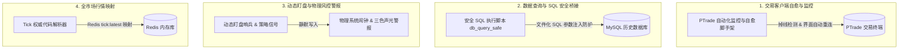

# Y3TRADE 量化自动化运维与辅助小工具集锦（脱敏版）

> **作者/量化工程团队**：QuantDev & Automated Trading Ops Team  
> **核心工具**：PTrade 界面自愈监控 · 安全 SQL 查询桥接 · 物理声光闹钟警报 · 实时 Tick 代码解算

---

## 一、 工具集锦概览

在量化交易系统的实际盘中运行中，除了核心策略与风控引擎外，还需要一系列高可用、无侵入的自动化运维辅助工具，保障系统 7x24 小时稳定运行。

本项目脱敏整理并集成了 Y3TRADE 系统的 **四大实用自动化工具**：



---

## 二、 核心小工具代码及技术亮点

### 1. PTrade 交易客户端自愈脚手架 (`ptrade_self_healing.py`)
- **功能**：自动检测 PTrade 客户端进程及 UI 控件状态。当发生断连、重启或弹窗阻塞时，自动执行模拟恢复与策略重新挂载。
- **防止假死**：对“重启中”与“正常监控中”状态建立二次强核验逻辑，避免由于状态误报导致策略漏挂。

### 2. 安全 SQL 执行与数据校验桥 (`db_query_safe.py`)
- **规范执行**：强制通过写入 `.sql` 文件避免命令行拼接注入漏洞；统一设置 `PYTHONIOENCODING=utf-8`。
- **自动化结果解析**：自动将 SQL 结果集转化为 Pandas DataFrame 或 JSON 结构供上层策略消费。

```python
# 脱敏示意：安全 SQL 执行脚本调用
import subprocess
import json

def run_safe_sql(sql_file_path):
    """
    通过安全的脚本桥接器执行文件化 SQL
    """
    cmd = ["python3", "scripts/db_query_safe.py", "-f", sql_file_path]
    res = subprocess.run(cmd, capture_output=True, text=True, check=True)
    return json.loads(res.stdout)
```

### 3. 物理声光警报与动态盯盘哨兵 (`alarm_watchdog.py`)
- **声光强提醒**：当做 T 网格触发止损或超量持仓警报时，系统自动调用本地系统层闹钟 API（如 `add_windows_alarm.py` 或 macOS `osascript` 提醒），实现硬性防错与极客物理提醒。

### 4. 49,000+ 实时行情 Tick 代码解算器 (`tick_resolver.py`)
- **权威代码转换**：基于 Redis `tick:latest` 内存缓存，毫秒级完成股票名称与 Standard Code (如 `600519.SH`) 的双向正向/反向解算，杜绝凭借记忆推断代码带来的误交易风险。

---

## 三、 工程价值

这些轻量小工具磨平了交易操作中的微观摩擦，形成了从**交易界面挂载、SQL 安全查询、物理声光防错到代码解析**的全链路零故障防线。

*(注：本小工具集锦文档已全面作商业名称、具体账户与环境凭据脱敏清洗)*
