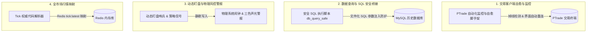

> **[ 🌐 English Version | 🇨🇳 [中文文档 (Chinese Version)](./11_quant_devops_tick_resolver_utilities_zh.md) ]**

# Y3TRADE Quantitative Automated Operations & Utility Toolkit Collection (Sanitized Edition)

> **Author/Quant Engineering Team**: QuantDev & Automated Trading Ops Team  
> **Core Tools**: PTrade UI Self-Healing Monitor · Secure SQL Query Bridge · Physical Audio-Visual Alarm Alert · Real-Time Tick Code Resolver

---

## I. Toolkit Collection Overview

In the actual intraday operation of a quantitative trading system, beyond the core strategy and risk control engines, a series of high-availability, non-invasive automated operations support tools are also required to ensure stable 7x24 operation of the system.

This project has sanitized, organized, and integrated the **four practical automation tools** of the Y3TRADE system:



---

## II. Core Utility Code and Technical Highlights

### 1. PTrade Trading Client Self-Healing Scaffold (`ptrade_self_healing.py`)
- **Function**: Automatically detects the PTrade client process and UI control states. When disconnection, restart, or modal dialog blocking occurs, it automatically performs simulated recovery and strategy re-mounting.
- **False-Death Prevention**: Establishes a secondary strong verification logic for the "restarting" and "normal monitoring" states, preventing strategies from being missed due to state misreporting.

### 2. Secure SQL Execution and Data Validation Bridge (`db_query_safe.py`)
- **Standardized Execution**: Enforces writing to `.sql` files to avoid command-line concatenation injection vulnerabilities; uniformly sets `PYTHONIOENCODING=utf-8`.
- **Automated Result Parsing**: Automatically converts SQL result sets into Pandas DataFrames or JSON structures for consumption by upper-layer strategies.

```python
# 脱敏示意：安全 SQL 执行脚本调用
import subprocess
import json

def run_safe_sql(sql_file_path):
    """
    通过安全的脚本桥接器执行文件化 SQL
    """
    cmd = ["python3", "scripts/db_query_safe.py", "-f", sql_file_path]
    res = subprocess.run(cmd, capture_output=True, text=True, check=True)
    return json.loads(res.stdout)
```

### 3. Physical Audio-Visual Alarm and Dynamic Watchdog Sentinel (`alarm_watchdog.py`)
- **Strong Audio-Visual Alert**: When grid trading triggers a stop-loss or over-position alert, the system automatically invokes the local system-level alarm API (such as `add_windows_alarm.py` or macOS `osascript` notification), achieving hard error prevention and geek-style physical alerts.

### 4. 49,000+ Real-Time Market Tick Code Resolver (`tick_resolver.py`)
- **Authoritative Code Conversion**: Based on the Redis `tick:latest` in-memory cache, completes bidirectional forward/reverse resolution between stock names and Standard Codes (e.g., `600519.SH`) at millisecond latency, eliminating the risk of erroneous trades caused by inferring codes from memory.

---

## III. Engineering Value

These lightweight utilities smooth out the micro-friction in trading operations, forming a full-chain zero-failure defense line spanning **trading UI mounting, secure SQL querying, physical audio-visual error prevention, and code resolution**.

*(Note: This utility collection document has been fully sanitized of business names, specific account and environment credentials)*
