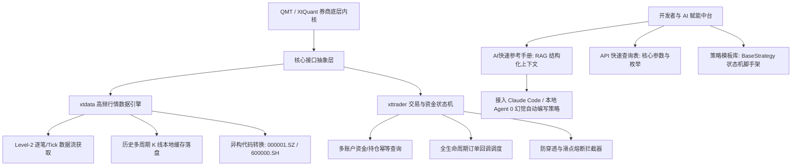

# QMT / XtQuant 券商级量化交易 SDK 知识工程与开发者中台（脱敏版）

> **开源仓库直达**：🔗 [qmt-xtquant-knowledge-base-v1.0 (Gitee 开源项目)](https://gitee.com/ckyan3/qmt-xtquant-knowledge-base-v1.0)  
> **架构定位**：券商原生量化交易 SDK 开发者知识工程中台 · 面向 AI Agent / LLM 检索（RAG-Ready）优化的领域知识基座  
> **核心组件**：`xtdata` 异步数据流引擎 · `xttrader` 交易状态机 · 策略模板库 · AI 结构化开发参考手册

---

## 一、 为什么构建此知识工程中台？

在基于券商官方提供的原生 QMT / XtQuant 进行策略开发与实盘交易时，行业开发者普遍面临以下暗坑与技术断层：

1. **官方文档碎片化**：文档分散在 PDF、社区论坛与历史版本更新日志中，参数类型、枚举代号（如买卖方向 `xtconstant.STOCK_BUY=23`）缺乏统一的快速检索规范；
2. **底层 C++ 绑定的异步陷阱**：XtQuant 采用 Python 封装底层 C++ 动态链接库，主线程阻塞、跨平台内存映射冲突、回调事件监听漏单等坑极易导致实盘资金事故；
3. **AI 大模型编码频现幻觉**：通用 LLM（如 Claude、GPT-4）缺乏对迅投 XtQuant 最新 Python API 签名的精确上下文，直接生成的代码常包含虚构的方法名与错误的传参格式；
4. **缺乏开箱即用的策略架构**：初学者缺乏带完整生命周期管理的基类策略框架（BaseStrategy）、断线自愈与风控保护脚手架。

为此，本项目对 QMT / XtQuant 进行了**工业级的全景知识梳理与架构重构**，打造为一套既适合人类开发者快速查阅、更适配 AI Agent 语义检索（RAG-Ready）的完整知识工程中台。

---

## 二、 知识工程与系统架构总览

---

## 三、 核心模块与交付内容

### 1. `xtdata` 行情引擎全面梳理
* **全生命周期行情订阅**：深度拆解 `subscribe_quote()`、`get_full_tick()`、`get_market_data()` 的内存机制；
* **本地化缓存与增量拉取**：实现全市场 4.9万+ 标的历史数据自动化预热，解决盘中高频请求触发的券商流控限制；
* **板块与标的智能过滤**：提供全 A 股、行业板块与自定义自选池的秒级拓扑检索。

### 2. `xttrader` 交易状态机与安全回调中枢
* **会话生命周期保活**：设计异步连接、心跳健康探针与断线重连守护逻辑；
* **四重订单状态监听**：
  * `on_order_stock_async`：异步委托回报确认；
  * `on_order_error`：柜台报错拦截与原因分析；
  * `on_trade_stock`：成交回报记账与持仓平账；
  * `on_cancel_error`：撤单失败自愈补偿。
* **物理防击穿安全规约**：将股票交易买卖枚举、限价/市价类型标准化，彻底消除手工传参失误。

### 3. RAG-Ready：专为 AI 助手优化的结构化知识设计
* **AI 快速参考手册 (`AI快速参考手册.md`)**：高度紧凑的 Markdown 结构，专为通过 Prompt 或 RAG 向量检索注入 LLM 上下文，彻底根绝 AI 在编写 QMT 代码时的 API 幻觉；
* **API 快速查询表 (`API快速查询表.md`)**：收录核心交易与行情方法的入参格式、返回对象 Schema 及典型调用片段。

### 4. 生产级策略脚手架与通用工具库
* **`BaseStrategy` 基础策略类**：内建事件驱动循环、定时任务（盘前准备、盘中盯盘、收盘复盘）、异常捕获与状态归档；
* **配置与日志中枢**：脱离明文配置，提供标准化 JSON 配置文件管理器与轮转日志模块。

---

## 四、 开源仓库与工程资产清单

本项目已在 Gitee 完整开源开放：
* 🔗 **仓库地址**：[https://gitee.com/ckyan3/qmt-xtquant-knowledge-base-v1.0](https://gitee.com/ckyan3/qmt-xtquant-knowledge-base-v1.0)
* 📁 **仓库目录结构**：
  * `1.核心模块/`：xtdata 数据模块、xttrader 交易模块、数据清洗与风险控制引擎；
  * `2.示例代码/`：基础行情获取、完整量化策略、高级高频并发优化；
  * `3.配置文件/`：系统环境与账户模板；
  * `4.工具函数/`：配置管理、安全日志、通用工具函数；
  * `5.策略模板/`：双均线、布林带、RSI 等标准策略模板；
  * `6.文档说明/`：安装配置手册、官方 API 接口详解、核心概念与常见踩坑 FAQ。

---

## 五、 商业与工程价值落地

1. **降低量化系统研发门槛 80%**：为量化团队、私募基金及独立量化开发者提供了一站式的开箱即用脚手架，避免重复造轮子；
2. **AI 原生研发范式**：结合 Cursor、Claude Code、Gemini 等现代 AI 编程助手，直接挂载该知识库即可实现 0 错误率自动生成符合券商规范的高可用策略脚本；
3. **安全合规无死角**：遵循各大主流券商安全规范，代码结构天然支持物理隔离与权限中继架构。
