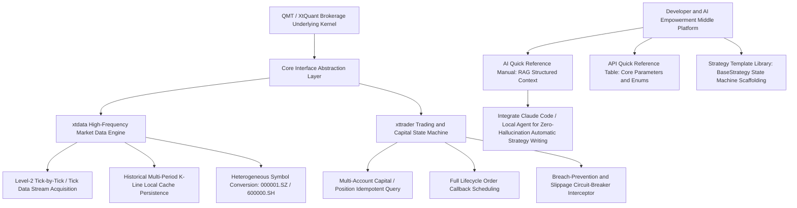

# QMT / XtQuant Brokerage-Grade Quantitative Trading SDK Knowledge Engineering and Developer Middle Platform (Sanitized Version)

> **Direct Link to Open-Source Repository**: 🔗 [qmt-xtquant-knowledge-base-v1.0 (Gitee Open-Source Project)](https://gitee.com/ckyan3/qmt-xtquant-knowledge-base-v1.0)  
> **Architectural Positioning**: Brokerage-native quantitative trading SDK developer knowledge engineering middle platform · Domain knowledge base optimized for AI Agent / LLM retrieval (RAG-Ready)  
> **Core Components**: `xtdata` asynchronous data stream engine · `xttrader` trading state machine · Strategy template library · AI structured development reference manual

---

## I. Why Build This Knowledge Engineering Middle Platform?

When developing strategies and running live trading on the brokerage-official native QMT / XtQuant, industry developers commonly encounter the following hidden pitfalls and technical fault lines:

1. **Fragmented official documentation**: Documentation is scattered across PDFs, community forums, and historical version changelogs; parameter types and enum codes (e.g., buy/sell direction `xtconstant.STOCK_BUY=23`) lack a unified, rapidly searchable specification;
2. **Async traps in the underlying C++ bindings**: XtQuant wraps a low-level C++ dynamic link library in Python; main-thread blocking, cross-platform memory-mapping conflicts, and missed orders from callback event listeners can easily cause live-trading capital incidents;
3. **Frequent hallucinations in AI large-model coding**: General-purpose LLMs (such as Claude, GPT-4) lack precise context for the latest XunTou XtQuant Python API signatures, and directly generated code often contains fabricated method names and incorrect argument formats;
4. **Lack of an out-of-the-box strategy architecture**: Beginners lack a base strategy framework (BaseStrategy) with full lifecycle management, along with scaffolding for disconnect self-healing and risk-control protection.

To this end, this project has performed **industrial-grade panoramic knowledge organization and architectural refactoring** of QMT / XtQuant, building it into a complete knowledge engineering middle platform that is both suitable for quick reference by human developers and better adapted to AI Agent semantic retrieval (RAG-Ready).

---

## II. Knowledge Engineering and System Architecture Overview

---

## III. Core Modules and Deliverables

### 1. Comprehensive Organization of the `xtdata` Market Data Engine
* **Full-lifecycle market data subscription**: In-depth deconstruction of the memory mechanisms of `subscribe_quote()`, `get_full_tick()`, and `get_market_data()`;
* **Localized caching and incremental fetching**: Automated pre-warming of historical data for 49,000+ symbols across the entire market, resolving brokerage flow-control limits triggered by high-frequency intraday requests;
* **Intelligent filtering of sectors and symbols**: Second-level topological retrieval across all A-shares, industry sectors, and custom watchlists.

### 2. `xttrader` Trading State Machine and Secure Callback Hub
* **Session lifecycle keep-alive**: Asynchronous connection design, heartbeat health probes, and disconnect-reconnect guardian logic;
* **Four-fold order state monitoring**:
  * `on_order_stock_async`: Asynchronous order acknowledgment;
  * `on_order_error`: Counterparty error interception and root-cause analysis;
  * `on_trade_stock`: Fill acknowledgment bookkeeping and position reconciliation;
  * `on_cancel_error`: Cancel-failure self-healing compensation.
* **Physical breach-prevention safety specification**: Standardizes stock trading buy/sell enums and limit/market order types, completely eliminating manual argument-passing errors.

### 3. RAG-Ready: Structured Knowledge Design Optimized for AI Assistants
* **AI Quick Reference Manual (`AI Quick Reference Manual.md`)**: A highly compact Markdown structure designed specifically for injection into LLM context via prompts or RAG vector retrieval, completely eradicating AI API hallucinations when writing QMT code;
* **API Quick Reference Table (`API Quick Reference Table.md`)**: A collection of input parameter formats, return object schemas, and typical invocation snippets for core trading and market data methods.

### 4. Production-Grade Strategy Scaffolding and General Utility Library
* **`BaseStrategy` base strategy class**: Built-in event-driven loop, scheduled tasks (pre-market preparation, intraday monitoring, post-close review), exception capture, and state archiving;
* **Configuration and logging hub**: Decoupled from plaintext configuration, providing a standardized JSON configuration file manager and rotating log module.

---

## IV. Open-Source Repository and Engineering Asset Inventory

This project is fully open-sourced on Gitee:
* 🔗 **Repository URL**: [https://gitee.com/ckyan3/qmt-xtquant-knowledge-base-v1.0](https://gitee.com/ckyan3/qmt-xtquant-knowledge-base-v1.0)
* 📁 **Repository Directory Structure**:
  * `1.Core Modules/`: xtdata data module, xttrader trading module, data cleaning and risk control engine;
  * `2.Example Code/`: Basic market data retrieval, complete quantitative strategies, advanced high-frequency concurrency optimization;
  * `3.Configuration Files/`: System environment and account templates;
  * `4.Utility Functions/`: Configuration management, secure logging, general utility functions;
  * `5.Strategy Templates/`: Standard strategy templates such as dual moving average, Bollinger Bands, and RSI;
  * `6.Documentation/`: Installation and configuration manual, official API interface details, core concepts and common pitfalls FAQ.

---

## V. Commercial and Engineering Value Realization

1. **Reduces the R&D barrier for quantitative systems by 80%**: Provides a one-stop, out-of-the-box scaffold for quant teams, private funds, and independent quant developers, avoiding reinventing the wheel;
2. **AI-native R&D paradigm**: Combined with modern AI coding assistants such as Cursor, Claude Code, and Gemini, directly mounting this knowledge base enables zero-error-rate automatic generation of brokerage-compliant, high-availability strategy scripts;
3. **No gaps in security and compliance**: Follows the security specifications of major mainstream brokerages; the code structure natively supports physical isolation and permission-relay architectures.
