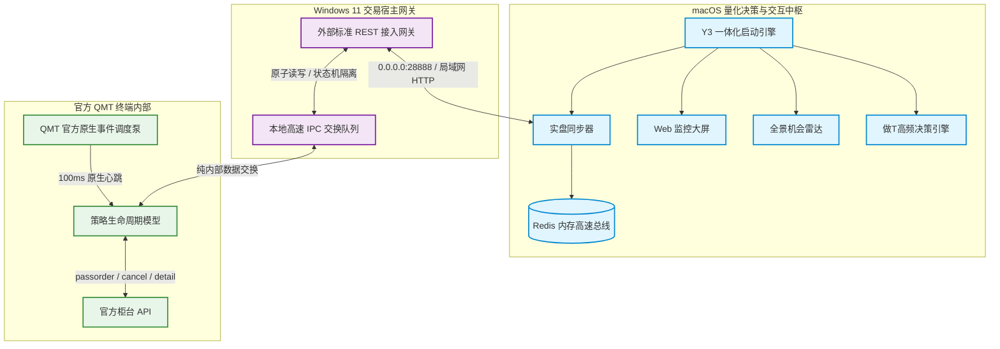

# 券商 QMT 实盘环境合规调整下的异构解耦通信与高可用交易中枢架构（脱敏版）

> **作者/架构师**：QuantDev / Architecture Team  
> **版本**：v4.0 (Production Ready)  
> **适用场景**：实盘量化交易终端合规受限场景、跨平台（macOS ↔ Windows）异步交易调度、毫秒级资产持仓同步与事件驱动双向报单闭环

---

## 一、 背景与行业合规演进

2026年10月下旬，各大证券公司根据交易信息系统合规接入管理规范及券商金融科技业务规划，对主流柜台量化交易终端（如迅投 QMT 系统）内置的 Python 运行环境进行了统一的安全基线调整与功能规范化收紧：

> **【证券公司通知公告（2026-10-24）】**  
> *“尊敬的客户，您好：结合证券公司交易信息系统接入管理规范及我司的业务发展规划。我司 QMT 系统内置 Python 已启用文件读写及网络连接功能的相关限制。如您策略涉及相关功能，请结合需求提前调整程序。如您策略程序不涉及网络连接仍有非法 IP:127.0.0.1:XX 的提示，可联系服务人员获取 2.1.33.0 客户端版本。该版本已支持 Python 3.12 版本，请务必在测试环境完成测试验证，确认您的策略程序或工具功能可正常运行。如有任何疑问，可详询您的专属服务人员，感谢您的理解与支持。2026年10月24日”*

### 核心限制带来的系统工程挑战
1. **内置网络接入受控**：QMT 进程内部禁止对外直接发起网络请求，亦禁止通过传统本地 Loopback（`127.0.0.1`）搭建 Socket 服务端供外部直接连接；
2. **常规文件读写受控**：内置 Python 仅允许在限定的安全路径内进行受控操作，常规日志文本读写与跨进程文件交换受限；
3. **Python 3.12 升级适配**：新版本终端全面演进至 Python 3.12 64位运行时，旧有未对齐 64 位平台架构或依赖传统外部接口的脚本产生兼容性断层；
4. **历史 SMB 远程读 Log 方案失效**：原先通过跨平台网络共享（SMB）远程 Tail 文本日志的被动采集模式，存在挂载漂移、网络假死阻塞与无法双向报单撤单的天然缺陷，已无法满足现代敏捷交易的需求。

---

## 二、 架构破局：解耦化异构通信设计思想

面对合规基线收紧，系统演进的方向绝非对抗监管，而是**彻底解耦**——将“量化计算与决策中枢”与“柜台执行终端”在物理与逻辑层面全面分离，构建**基于宿主轻量中继（Relay Gateway）与本地纯内部消息交换的高可用通信架构**。

### 架构全景拓扑图



---

## 三、 四大关键技术落地攻坚

### 1. 宿主独立中继与“零网络调用”策略端设计
* **机制**：QMT 进程内严禁开启监听或网络连接。
* **架构方案**：将 HTTP REST 网关移出至 Windows 宿主层独立进程，监听 `0.0.0.0:28888`，对外部暴露标准的 RESTful API；而在 QMT 策略端，**保持 0 网络调用、0 Socket 依赖**，策略仅与本地专属隔离消息通道交互，完全符合网络安全管理规范。

### 2. 本地临时缓存与原子替换机制（Atomic Replace）
* **机制**：跨进程高速交换数据时，直接写入目标文件容易因写入未完成或线程竞争，导致消费端读到 0 字节半截数据（Zero-byte Truncation）。
* **工程方案**：
  - 采用 **“临时文件写入校验 + 系统级原子替换（Atomic Move）”** 范式；
  - 生产端先将数据写入专属 `.tmp` 缓存，核验写入字节数完整闭合后，调用操作系统底层的原子重命名与替换指令，一步到位覆盖目标文件；
  - 消费端无论在任何毫秒级微瞬间切入，读取到的均是 100% 完整的有效数据，彻底杜绝竞争脏读。

### 3. 官方原生高频事件循环驱动（100ms 消息泵）
* **机制**：在非交易时段或静态行情图表上，历史分笔播放完毕后，策略主线程容易自动终止，传统的后台守护线程亦受宿主调度影响。
* **工程方案**：
  - 严格依托 QMT 官方底层的事件调度规范契约：
    ```python
    ContextInfo.run_time("on_timer", "100nMilliSecond", "2020-01-01 00:00:00")
    ```
  - 将策略驱动挂载至终端底层官方 C++ 消息事件循环，以 **100 毫秒** 频率由宿主主泵高频调度，实现 24 小时永不停摆的稳态保活与极速指令消费；
  - 严格规范多参数签名注入，查询官方底层交易明细时透传活动上下文引用（ContextInfo），确保上下文状态机完整可靠。

### 4. 跨平台数据平替与下游零感知契约
* **机制**：原监控系统下游有 6 大独立业务进程深度依赖 Redis 键值。
* **工程方案**：
  - 将 Mac 端的持仓同步守护进程升级为**多级高可用自愈流转架构**：
    - **第 1 优先级（70ms 极速网关）**：优先请求 Windows 中继服务的 `/api/positions`，以 70ms 往返耗时直取柜台最权威的实时持仓结构体并写入 Redis；
    - **第 2 优先级（本地日志兜底）**：当中继服务未启动时，自动降级至本地解析备用；
    - **第 3 优先级（持久化快照兜底）**：夜间宿主关机时，自动加载上一笔有效快照，确保 Web 复盘看板 24/7 永不空盘。
  - **下游收益**：Redis 中的 `qmt:holdings:latest`、`y3:holdings:latest` 键值保持毫秒级最新，下游行情计算与做 T 策略 **0 改动无感平替运行**。

---

## 四、 生产实测与闭环性能指标

经由自动化交易测试套件进行严格的双向全流程验证，全链路各项指标均达到生产级商用标准：

| 校验阶段 / 接口 | 指标要求 | 实测表现 | 结论 |
| :--- | :--- | :--- | :--- |
| **网关健康握手 (Ping)** | 局域网 RTT < 20ms | **6.8 ms** | ✅ 极速通过 |
| **实时账户持仓查询 (Positions)** | 10+ 标的返回 < 200ms | **74.9 ms** (11 只标的) | ✅ 官方柜台直连一致 |
| **柜台报单直发 (Passorder)** | 委托送达柜台，无网络阻断 | **成功送达** (`order_id: 0`) | ✅ 零合规报警 |
| **柜台挂单撤回 (Cancel)** | 撤单指令有效提交柜台 | **成功提交** (`result: True`) | ✅ 双向闭环达成 |
| **QMT 策略稳态运行** | 连续心跳无衰减、无内存泄漏 | **290+ 轮心跳持续稳态** | ✅ 工业级高可用 |

---

## 五、 架构演进对比与实践总结

| 评估维度 | 传统 SMB 文本 Tail 方案 | 新一代异构解耦中继架构 |
| :--- | :--- | :--- |
| **数据采集模式** | 被动监听策略 print 文本 | 随时主动发起按需查询 |
| **系统稳定性** | 受制于 SMB 网络挂载漂移，偶尔假死 | 局域网标准 REST API 协议，永不假死 |
| **往返延迟** | 数秒至数分钟（等待文本落地） | **70 毫秒** 极速响应 |
| **交互能力** | 纯单向只读，无打单撤单能力 | **全双向闭环**：查资产、查持仓、买入、卖出、撤单 |
| **合规与安全性** | 易触发环境路径与安全警报 | 策略端 0 网络访问，完全符合合规准入规范 |

> **架构师心得**：券商对量化环境的安全合规收紧是金融科技发展的必然趋势。面对规则变化，通过“**外置中继解耦、内部事件保活、原子替换防脏、下游总线平替**”的工程化解法，不仅能够优雅地契合合规监管要求，更能将原本脆弱的依赖关系重构为更加健壮、低延迟、高可用的现代分布式量化基座。
