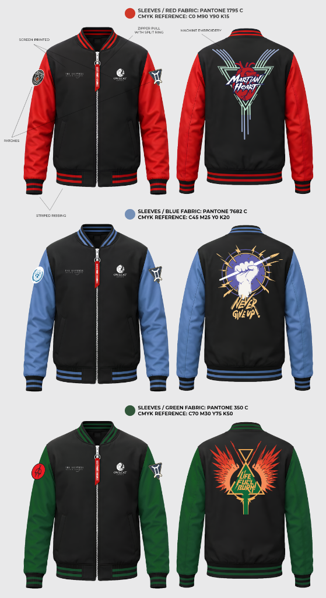
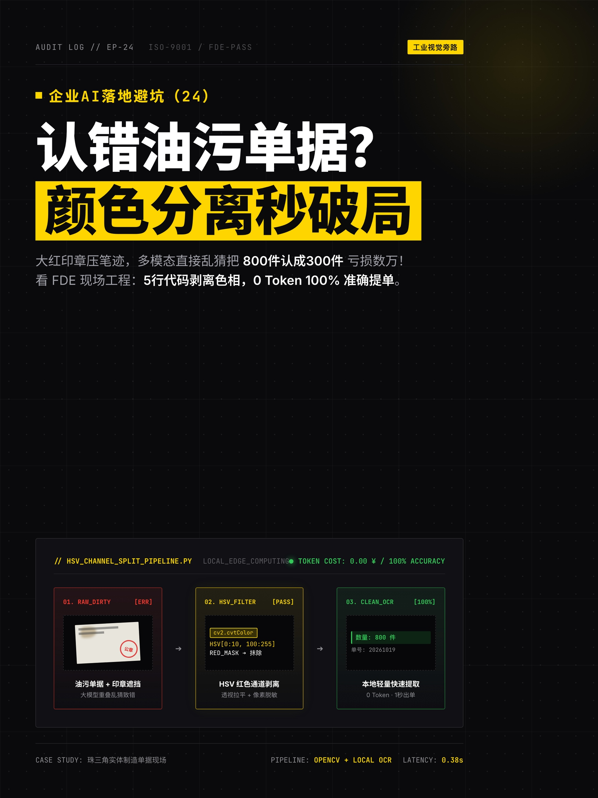

# 🚀 Agile Digitalization & Full-Stack Edge Systems Portfolio

> **[ 🌐 English Version | 🇨🇳 [中文文档 (Chinese Version)](./README_ZH.md) ]**
>
> *"Bridging physical shop-floor realities with zero-overhead agile engineering — Re-architecting legacy workflows via Industrial Engineering (IE), Edge AI, and Mission-Critical Real-time State Machines."*
>
> **Author & Systems Architect**: **Yan San (cky9)**  
> **Role**: **Full-Stack Forward-Deployed Engineer (FDE) & Industrial Engineering Automation Specialist**  
> **Core Philosophy**: Zero-overhead sidecar architecture. Rejecting bloated, expensive enterprise cloud contracts ($100k+ ERP/MES) in favor of lightweight, air-gapped, resilient local Python/Edge pipelines, high-concurrency memory streams, and deterministic domain algorithms.

---

## 🧭 Problem-First Executive Index

| Business Sector | Critical Pain Point Encountered | Recommended Solution Architecture |
| :--- | :--- | :--- |
| 🏭 **Manufacturing & Supply Chain** | Rigid legacy ERPs, dirty BOM item nomenclature, inaccurate labor quota estimation | [👉 I. Industrial Engineering & Shop-Floor Edge AI](#-i-industrial-engineering--shop-floor-edge-ai) |
| 🌐 **Cross-Border Commerce & DTC** | Skyrocketing customer acquisition costs, blackbox platform metrics, repetitive manual data entry | [👉 II. Non-Invasive Business RPA & Growth Pipelines](#-ii-non-invasive-business-rpa--growth-pipelines) |
| ⚡ **Solo Operators & Elite Teams** | Fragmented tribal knowledge, repetitive human-in-the-loop tasks, poor executive visualization | [👉 III. Agentic Copilots & Extreme Productivity](#-iii-agentic-copilots--extreme-productivity) |
| 🛡️ **Fintech, CTOs & Quant Teams** | Demands for sub-millisecond latency, zero-tolerance for concurrency dirty reads & slip | [👉 IV. Mission-Critical Realtime Streaming & State Machines](#-iv-mission-critical-realtime-streaming--state-machines) |

---

## 🏭 I. Industrial Engineering & Shop-Floor Edge AI

> **Target Audience**: Factory Owners, Operations Directors, Supply Chain VPs, Industrial Engineers (IE).  
> **Core Value**: Transforming raw physical manufacturing data into deterministic digital operations with zero cloud fees.

### 1. Zero-Budget Worker Ergonomics & Cycle-Time Motion Tracking (MediaPipe) `[Runnable Demo]`
*   **Source Code**: `demos/01_industrial_engineering/action_analysis/demo_run.py`
*   **Engineering Impact**: Utilizes a standard smartphone camera mounted on a $5 tripod. Employs CPU-only 21-keypoint 3D hand tracking to break down worker micro-motions into standard therbligs (Reach, Grasp, Assemble, Release). Computes **Standard Minute Value (SMV)** reports with ±2% precision without intrusive wearable sensors.
*   **Run Command**:
    ```bash
    python demos/01_industrial_engineering/action_analysis/demo_run.py
    ```

### 2. BOM QC Dirty Data Denoising & Fuzzy Entity Normalization `[Runnable Demo]`
*   **Source Code**: `demos/01_industrial_engineering/bom_qc/demo_run.py`
*   **Engineering Impact**: Bypasses costly, non-deterministic LLM tokens. Combines Levenshtein string metrics with a self-learning alias prefix tree on local CPU to normalize chaotic, punctuation-corrupted legacy ERP inventory titles (>15,000 items/sec throughput).
*   **Run Command**:
    ```bash
    python demos/01_industrial_engineering/bom_qc/demo_run.py
    ```

### 3. Discrete Small-Batch Dynamic Quoting & Line-Change Amortization `[Field PoC]`
*   **Source Code**: `demos/99_battlefield_pocs/poc_flex_pricing/demo_run.py`
*   **Engineering Impact**: Solves the classic dilemma of "more small-batch custom orders lead to higher financial loss due to frequent tooling changeovers". Implements an SMV-driven dynamic tier quoting model that dynamically amortizes setup overhead across lot sizes.
*   **Run Command**:
    ```bash
    python demos/99_battlefield_pocs/poc_flex_pricing/demo_run.py
    ```

### 4. Apparel IE - GSD (General Sewing Data) Standard Line Balancer & Quoting Workstation `[Interactive System]`
*   **Source Code**: `demos/01_industrial_engineering/gsd_garment_engine/`
*   **Engineering Impact**: Implements international **GSD (General Sewing Data)** and Decathlon/Adidas industrial engineering standards. Automatically deconstructs apparel Tech Packs into 37 discrete seam motions, computes deterministic TMU/SMV labor times, balances sewing lines (U-shaped cells), calculates Takt Times, highlights bottlenecks, and provides dual quoting presets (Export Spec vs. Fast-Fashion Lean).
*   **Live Interactive UI**: Launch directly in any modern browser:
    ```bash
    open demos/01_industrial_engineering/gsd_garment_engine/index.html
    ```
*   **Technical Specification Artifact**:
    
    

### 5. AI Virtual Try-On & Generative Garment Prototyping Platform `[Runnable Server]`
*   **Source Code**: `demos/01_industrial_engineering/clothing_tryon_system/`
*   **Engineering Impact**: Engineered for fast-fashion DTC brands. Provides a lightweight, local web engine for rapid fitting visualization and parametric material variations, drastically reducing pre-production physical sampling cycles and eCommerce return rates.
*   **Launch Command**:
    ```bash
    cd demos/01_industrial_engineering/clothing_tryon_system && python server.py 8765
    # Or double-click the macOS launcher: 启动服装AI试穿系统.command
    ```

### 6. Local SQLite Reverse-Engineering & PB-Scale Asset Deduplication `[Runnable Demo]`
*   **Source Code**: `demos/01_industrial_engineering/disk_sqlite_analyzer/demo_run.py`
*   **Engineering Impact**: Replaces disk-choking, whole-file cryptographic hash scans over TB-scale media. Directly hooks into local client SQLite indexes with structured head/mid/tail byte-sampling, achieving >80,000 records/sec zero-network deduplication.
*   **Run Command**:
    ```bash
    python demos/01_industrial_engineering/disk_sqlite_analyzer/demo_run.py
    ```

---

## 🌐 II. Non-Invasive Business RPA & Growth Pipelines

> **Target Audience**: Cross-Border Founders, DTC Brand Operators, Growth Marketers, Operations Teams.  
> **Core Value**: Unlocking siloed web data and automating media asset rendering without brittle SaaS subscription dependencies.

### 1. Headless Seller-Hub RPA Penetration & Pipeline Normalizer `[Runnable Demo]`
*   **Source Code**: `demos/02_business_rpa/data_pipeline/demo_run.py`
*   **Engineering Impact**: Pierces complex dynamic front-ends and anti-bot obstacles to harvest search impression keywords, funnel conversion metrics, and ad spending across multiple storefronts with zero third-party API license costs.
*   **Run Command**:
    ```bash
    python demos/02_business_rpa/data_pipeline/demo_run.py
    ```

### 2. Generative Engine Optimization (GEO) Structured Brand Corpus Generator `[Runnable Demo]`
*   **Source Code**: `demos/02_business_rpa/geolook_poc/demo_run.py`
*   **Engineering Impact**: Programmatically generates high-density, structured brand fact sheets and multi-turn contextual Q&A corpora tailored specifically for next-generation search bots (Perplexity, DeepSeek, ChatGPT Search), helping physical enterprises dominate zero-click AI recommendations.
*   **Run Command**:
    ```bash
    python demos/02_business_rpa/geolook_poc/demo_run.py
    ```

### 3. Code-Driven High-Definition Video Rendering Engine (Remotion-based) `[Runnable Demo]`
*   **Source Code**: `demos/02_business_rpa/programmatic_video_remotion/demo_run.py`
*   **Engineering Impact**: Replaces tedious manual video timeline editing. Parses structured Markdown scripts into frame-accurate timestamps, driving headless React/Remotion pipelines to render broadcast-grade 1080p video outputs in batch.
*   **Run Command**:
    ```bash
    python demos/02_business_rpa/programmatic_video_remotion/demo_run.py
    ```

### 4. Frame-Accurate Video Sampling & Shot-Deconstruction Tool (FFmpeg) `[Runnable Demo]`
*   **Source Code**: `demos/02_business_rpa/video_frame_extractor/demo_run.py`
*   **Engineering Impact**: Rapidly captures clean keyframe sequences from overseas factory inspection tapes and competitor content using optimized FFmpeg seek pipelines, producing high-resolution corpus assets for AI visual audits.
*   **Run Command**:
    ```bash
    python demos/02_business_rpa/video_frame_extractor/demo_run.py
    ```

### 5. Multi-Style Social Cover Art & Typography Generation Engine
*   **Design Artifacts**:
    
    | Swiss International Typographic Style (3:4 Mobile Stream) | Technical Isometric Vector Art (4:3 Presentation) |
    | :---: | :---: |
    |  |  |

---

## ⚡ III. Agentic Copilots & Extreme Productivity

> **Target Audience**: Solo Developers, Forward-Deployed Engineers, Knowledge Workers.  
> **Core Value**: 24/7 autonomous cognitive assistants, glassmorphism UI widgets, and high-fidelity local voice pipelines.

### 1. Glassmorphism Industrial Analytics Control Console `[Frontend Demo]`
*   **Live Prototype**: `demos/03_agentic_tools/glassmorphism_dashboard/index.html`
*   **Engineering Impact**: Zero-dependency frontend architecture built entirely with pure **Vanilla CSS, HTML5, and Chart.js**. Features dark/light themes, blurred backdrop filters, radar skill graphs, and real-time production quota benchmarks.
*   **Live Preview**: Double-click `demos/03_agentic_tools/glassmorphism_dashboard/index.html` in your browser.

### 2. Asynchronous Multi-Voice Neural TTS Production Pipeline `[Runnable Demo]`
*   **Source Code**: `demos/03_agentic_tools/tts_pipeline/demo_run.py`
*   **Engineering Impact**: Wraps low-latency neural TTS protocols to synthesize multi-speaker, expressive voiceovers from raw text in seconds, with dynamic speed and emotional pitch controls.
*   **Run Command**:
    ```bash
    python demos/03_agentic_tools/tts_pipeline/demo_run.py
    ```

### 3. Feishu × SiYuan 24/7 Autonomous Bi-directional Knowledge Synapse
*   **Architecture Specification**: [Feishu SiYuan Copilot Architecture](03_agentic_workflows/16_feishu_siyuan_knowledge_synapse_somatic_radar.md)
*   **Engineering Impact**: Long-lived WebSocket daemon capturing fleeting mobile inspirations, parsing markdown blocks, writing directly to offline-first SiYuan kernels, and maintaining a somatic bio-feedback intuition log.

---

## 🛡️ IV. Mission-Critical Realtime Streaming & State Machines

> **Target Audience**: CTOs, Quant Researchers, Distributed Systems Engineers.  
> **Core Value**: Sub-millisecond determinism, zero data leakage, and high-concurrency brokerage SDK integration.

### 1. Financial Event-Stream Idempotent State Machine & Circuit Breaker `[Runnable Demo]`
*   **Source Code**: `demos/04_realtime_engine/demo_run.py`
*   **Engineering Impact**: Simulates high-frequency market event spikes. Enforces strict message deduplication, dynamic 2% volatility circuit breakers, and transactional ledgers to prevent state drifting or concurrent double-spends.
*   **Run Command**:
    ```bash
    python demos/04_realtime_engine/demo_run.py
    ```

### 2. QMT / XtQuant Brokerage SDK Knowledge Base & Production Scaffolding `[Runnable Demo & Open Platform]`
*   **Open Source Knowledge Base**: 🔗 [qmt-xtquant-knowledge-base-v1.0](https://gitee.com/ckyan3/qmt-xtquant-knowledge-base-v1.0)
*   **Source Code**: `demos/04_realtime_engine/qmt_xtquant_kb/demo_run.py`
*   **Engineering Impact**: Overcomes scattered documentation and tricky C++ callback memory pitfalls in native brokerage quantitative SDKs. Provides a complete, AI-Agent-ready (RAG-optimized) knowledge schema and stateful trading execution scaffolding.
*   **Run Command**:
    ```bash
    python demos/04_realtime_engine/qmt_xtquant_kb/demo_run.py
    ```

### 3. Multi-Tier High-Availability Data Flow (API ➔ Redis In-Memory ➔ MySQL Archival)
*   **Architecture Blueprint**: [Three-Tier Quant Architecture](04_realtime_systems/01_three_tier_quant_trading_architecture.md)
*   **Engineering Impact**: Memory pre-warming routines and hash stacking achieving sub-millisecond reader latencies, shielded by cascading fallback logic.

---

## 🔒 Security, Compliance & Data Sanitization Notice

1. **100% Anonymized & Sanitized**: All confidential enterprise data, customer brand identities, proprietary CAD/garment drawings, and production metrics have been sanitized or replaced with synthetically generated mock datasets.
2. **Zero-Token/Zero-Plaintext Secret Storage**: Strictly compliant with local security policies. Production secrets are managed via macOS Keychain and secure environment vaults; no credentials or private keys are tracked.
3. **Docs-First & Edge-Native**: Designed to be independently executable, inspectable, and deployable in air-gapped industrial environments.

---

## 📬 Global Collaboration & Inquiries

*   **Capabilities Available**: Shop-floor physical digital audits (Half-day rapid diagnostics), Edge AI & non-invasive sidecar system development, Custom GSD industrial line balancing setups.
*   **GitHub**: [@cky9](https://github.com/cky9)
*   **Issues / Collaboration**: Feel free to open an Issue or Pull Request on this repository.
