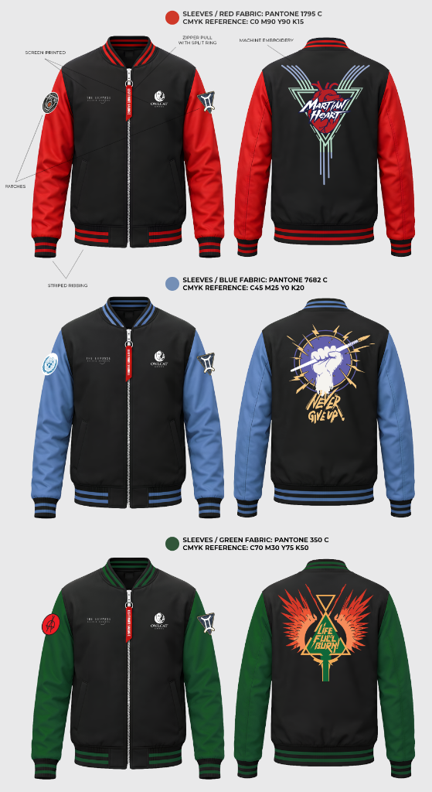
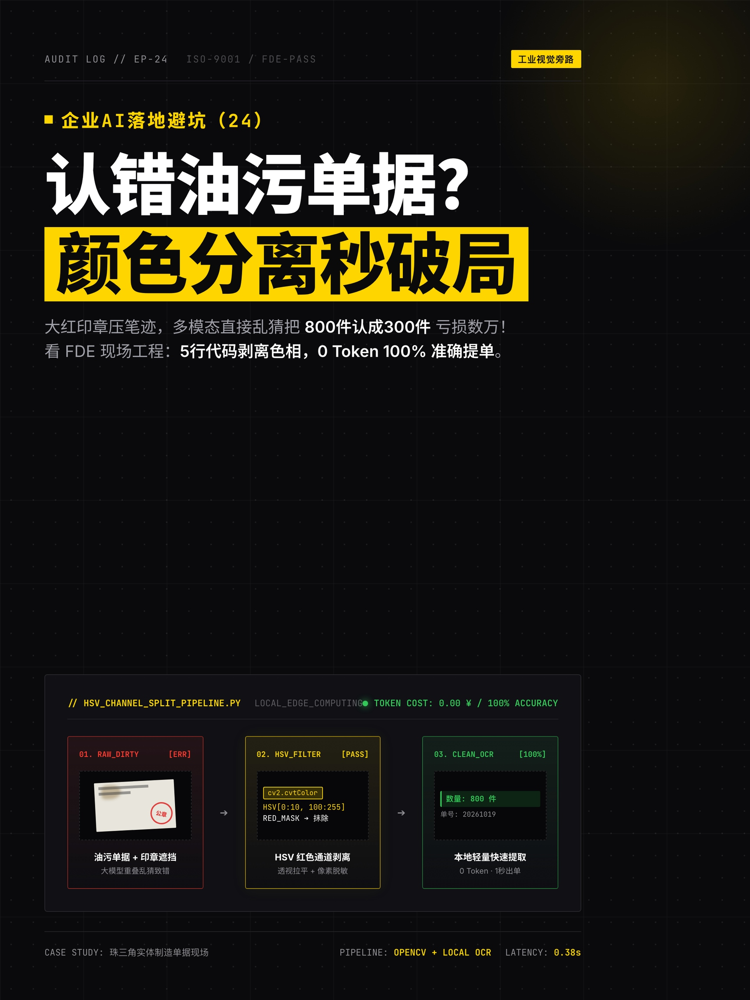
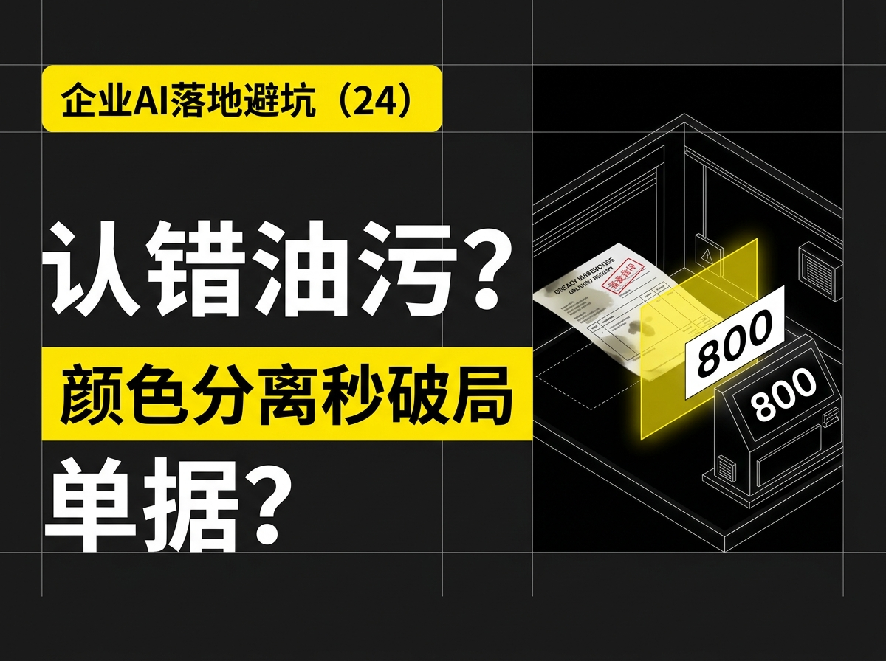

# 🚀 敏捷数字化与全栈企业工程作品集 (Digital Agility & Edge AI Systems)

> **[ 🌐 English Version (Click to view English README)](./README.md) | 🇨🇳 中文版**
> 
> **“以工业工程（IE）重构业务流，用 0 预算敏捷代码打碎数字化高墙。”**
>
> 我是一名 **全栈敏捷数字化工程师（FDE） & 工业工程提效专家**。我不做空洞的概念包装与昂贵的云原生堆砌，专注深入车间流水线、外贸跨境与企业一线真实脏数据现场，基于 **Python / 本地轻量视觉与大模型 / RPA 自动化 / 高可用内存流** 构建 0 成本、抗风险、旁路物理隔离的成长型数字化系统。

---

## 🧭 快速场景导航 (按老板业务痛点直达)

| 您的业务领域 | 您面临的现实痛点 | 建议优先查看的解决方案大类 |
| :--- | :--- | :--- |
| 🏭 **实体制造业 / 工厂 / 供应链** | 传统 ERP 昂贵僵化、物料命名混乱脏数据、工时动作测定人力成本高 | [👉 一、实体制造与工厂数字化](#-一实体制造与工厂数字化-industrial-engineering--edge-ai) |
| 🌐 **外贸出海 / 跨境电商 / 实体品牌** | 投流成本飙升、多店铺单品曝光数据黑盒、海量单据重复手工录入 | [👉 二、业务自动化与无侵入增长管道](#-二业务自动化与无侵入增长管道-business-rpa--growth-ops) |
| ⚡ **团队协同 / 知识机构 / 超级个体** | 非结构化知识资产沉淀难、碎片化信息无法形成闭环决策看板 | [👉 三、智能体工作流与超级个人生产力](#-三智能体工作流与超级个人生产力-agentic-workflows--copilots) |
| 🛡️ **技术总监 / 架构师 / 高并发业务** | 极度苛求系统健壮性、要求高并发秒级吞吐、绝不容许并发脏读与穿透 | [👉 四、高可用实时数据流与金融级状态机](#-四高可用实时数据流与金融级状态机-mission-critical-realtime-engine) |

---

## 🏭 一、实体制造与工厂数字化 (Industrial Engineering & Edge AI)

> **受众画像**：适合实体制造厂、五金/照明/供应链老板、IE精益主管。（痛点：痛恨昂贵ERP、工时定额靠猜、老系统脏数据严重）

### 1. 0预算工人工时与动作节拍分析 (MediaPipe) `[可运行 Demo]`
*   **实证源码**：`demos/01_industrial_engineering/action_analysis/demo_run.py`
*   **业务价值**：仅需 15 元手机支架录制视频，纯单机 CPU 追踪双手 21 关节点轨迹，自动解算伸手、抓取、装配、放回等动素节拍，直出 **IE 标准工时 (SMV)** 报表，产能推算零误差。
*   **运行命令**：`python demos/01_industrial_engineering/action_analysis/demo_run.py`

### 2. BOM QC 脏数据去噪与非标物料归一化 `[可运行 Demo]`
*   **实证源码**：`demos/01_industrial_engineering/bom_qc/demo_run.py`
*   **业务价值**：放弃昂贵大模型 API，纯 CPU 运行编辑距离算法与自学习别名表树，在毫秒级内实现老旧 ERP 中中英文标点混乱、别名重叠脏物料的自动归一化对齐（吞吐 > 15,000 条/秒）。
*   **运行命令**：`python demos/01_industrial_engineering/bom_qc/demo_run.py`

### 3. 离散制造小批量柔性排单与阶梯报价模型 `[战地 PoC]`
*   **实证源码**：`demos/99_battlefield_pocs/poc_flex_pricing/demo_run.py`
*   **业务价值**：针对小批量定制订单“频繁换模调线导致干得越多亏得越多”的痛点，4小时构建基于工时定额 SMV 均摊调机固定费用的动态报价算法模型。
*   **运行命令**：`python demos/99_battlefield_pocs/poc_flex_pricing/demo_run.py`

### 4. 服装 IE - GSD 标准工时拆解、智能报价与产线排单系统 `[可运行 Demo]`
*   **实证源码**：`demos/01_industrial_engineering/gsd_garment_engine/`
*   **业务价值**：基于国际通用 **GSD (General Sewing Data)** 代码库与迪卡侬精益标准，自动解析款式工艺图纸（Tech Pack），秒级解算纯缝纫工序 SOT/SMV 标准工时、智能平衡工序瓶颈与机种设备配置（平车/包缝/坎车/无缝压胶），自动生成流水线平衡率（Line Balancing）与加工费报价单。
*   **交互大屏**：直接在浏览器双击打开 `demos/01_industrial_engineering/gsd_garment_engine/index.html` 即开即用。
*   **工艺拆解图纸凭证**：
    
    

### 5. 服装个性化设计与 AI 虚拟试穿/试衣平台 `[可运行 Demo]`
*   **实证源码**：`demos/01_industrial_engineering/clothing_tryon_system/`
*   **业务价值**：面向服装电商、柔性快反与 DTC 独立站，提供纯本地轻量化 AI 虚拟试衣与个性化设计平台。支持用户上传人像与版型材质参数，秒级预览试穿适配效果，降低打样与退货成本。
*   **启动方式**：进入目录运行 `python server.py 8765` 或直接双击 `启动服装AI试穿系统.command`。

### 6. 本地客户端 SQLite 逆向解析与多媒体资产极速排重 `[可运行 Demo]`
*   **实证源码**：`demos/01_industrial_engineering/disk_sqlite_analyzer/demo_run.py`
*   **业务价值**：面对本地/NAS 中 TB 级图片视频，放弃阻塞磁盘的全盘哈希，通过直接逆向客户端本地已有的 SQLite 缓存数据库，提取已有元数据配合“头中尾哈希采样”，实现纯单机每秒吞吐 80,000+ 条记录的 0 网络传输极速排重。
*   **运行命令**：`python demos/01_industrial_engineering/disk_sqlite_analyzer/demo_run.py`

### 7. 传统制造企业轻量级 AI 数字化提效与无侵入架构方案 `[深度架构]`
*   **架构文档**：📄 [02_传统制造企业轻量级AI数字化提效与无侵入式架构方案_脱敏版.md](01_industrial_engineering/02_non_invasive_edge_ai_factory_architecture.md)
*   **方案亮点**：Zero-Touch 零修改旧 MES/ERP 系统、车间移动端扫码定位、外挂式 BOM 用料自动对比防错引擎、现场三色声光警报联动。

### 8. PB 级私有多源多媒体资产智能治理与特征去重中台 `[深度架构]`
*   **架构文档**：📄 [18_PB级私有多源多媒体资产智能治理与特征去重中台_脱敏版.md](01_industrial_engineering/18_pb_scale_multimedia_deduplication_engine.md)
*   **方案亮点**：本地客户端数据库逆向解析秒级解算文件拓扑、头中尾采样哈希去重、私有云图库协同增量导入流水线。

### 9. STEM 理科知识图谱 DAG 溯源与数形结合智能诊断私教系统 `[深度架构]`
*   **架构文档**：📄 [15_STEM中小学理科知识图谱DAG溯源与数形结合智能诊断私教系统_脱敏版.md](01_industrial_engineering/15_stem_knowledge_graph_dag_tutoring_system.md)
*   **方案亮点**：531 个官方考点 DAG 拓扑溯源、零依赖单文件数形结合动态课件 (HTML/SVG)、费曼口述解题认知 CT 扫描诊断。

---

## 🌐 二、业务自动化与无侵入增长管道 (Business RPA & Growth Ops)

> **受众画像**：适合外贸出海老板、跨境电商卖家、实体品牌方、营销增长团队。（痛点：投流贵转化低、平台数据被封锁在后台、多单据重复录入）

### 1. 电商商家后台无侵入 RPA 穿透与脏数据清洗 `[可运行 Demo]`
*   **实证源码**：`demos/02_business_rpa/data_pipeline/demo_run.py`
*   **业务价值**：穿透复杂的前端框架，零 API 采购成本采集单品曝光词、转化漏斗与花费数据，并在本地 Python 管道完成多币种折算与归一化入库。
*   **运行命令**：`python demos/02_business_rpa/data_pipeline/demo_run.py`

### 2. 大模型 GEO 自动化品牌事实卡与母语料生成 `[可运行 Demo]`
*   **实证源码**：`demos/02_business_rpa/geolook_poc/demo_run.py`
*   **业务价值**：逆向输出 DeepSeek、豆包、Kimi 最偏好的结构化企业客观事实卡与 20+ 真实场景问答母语料，助实体企业 0 广告费抢占 AI 搜索推荐位。
*   **运行命令**：`python demos/02_business_rpa/geolook_poc/demo_run.py`

### 3. 代码驱动短视频全自动渲染流水线 (Remotion-based) `[可运行 Demo]`
*   **实证源码**：`demos/02_business_rpa/programmatic_video_remotion/demo_run.py`
*   **业务价值**：摒弃传统人工逐轨拖拽剪辑，将 Markdown 剧本自动解析为毫秒级视频帧时间轴（Frame Timeline），调用 React/Remotion 无头渲染引擎自动生成 1080p 工业级短视频。
*   **运行命令**：`python demos/02_business_rpa/programmatic_video_remotion/demo_run.py`

### 4. 视频关键帧等间隔抽取与分镜采风工具 (FFmpeg) `[可运行 Demo]`
*   **实证源码**：`demos/02_business_rpa/video_frame_extractor/demo_run.py`
*   **业务价值**：针对海外看厂实录、竞争对手爆款短视频，基于 FFmpeg 实现免下大文件的等间隔关键帧切片捕获，秒级输出高质量分镜序列，为 AI 视觉审计与动作拆解提供标准语料。
*   **运行命令**：`python demos/02_business_rpa/video_frame_extractor/demo_run.py`

### 5. MAC 代理中继与自动化反爬虫工具箱 `[深度架构]`
*   **架构文档**：📄 [09_MAC代理中继与自动化反爬虫工具箱_脱敏版.md](02_business_rpa/09_mac_proxy_relay_anti_scraping_toolkit.md)
*   **方案亮点**：动态代理中继、HTTP/SOCKS5 一键开关与请求头防封规则、多语言文本清洗与大批量历史数据保存机制。

### 6. 基于 MCP 协议的 AI 智能体工作流与精准订单匹配系统 `[深度架构]`
*   **架构文档**：📄 [14_基于MCP协议的AI智能体工作流与Upwork精准提案系统_脱敏版.md](02_business_rpa/14_mcp_agentic_workflow_proposal_system.md)
*   **方案亮点**：Linux 基金会标准 MCP 原生集成、32+ 项标准原子工具沙箱、真实工程代码资产驱动的自动化提案引擎。

### 7. AI 短视频全流程自动化出片与内容矩阵 SOP `[深度架构]`
*   **架构文档**：📄 [03_AI短视频全流程自动化出片与内容矩阵SOP_脱敏版.md](02_business_rpa/03_automated_video_rendering_matrix_sop.md)
*   **方案亮点**：爆款矩阵四大支柱与商业心法、手机剪映图文成片 SOP、“5分钟文案+1分钟自动化剪辑”流水线。
*   **高品质视觉封面资产凭证**：
    
    | 瑞士国际主义审计风 (3:4 抖音主页瀑布流) | AI 等轴测技术海报风 (4:3 横屏大图) |
    | :---: | :---: |
    |  |  |

### 8. 参数化 Web PPT 与瑞士国际主义风格社交卡片生成引擎 `[深度架构]`
*   **架构文档**：📄 [17_基于现代Web技术的参数化PPT与瑞士国际主义风格社交卡片生成引擎_脱敏版.md](02_business_rpa/17_parametric_web_slides_swiss_social_cards.md)
*   **方案亮点**：单 HTML 自包含演示文稿、BroadcastChannel 双屏演讲者同步、瑞士国际主义风格社交卡片与实况照片多宫格拼图。

---

## ⚡ 三、智能体工作流与超级个人生产力 (Agentic Workflows & Copilots)

> **受众画像**：适合超级个体、高效协作团队、知识型机构、企业内部数字化提效主管。（痛点：碎片信息散乱、重复性机械劳动、缺乏美学呈现）

### 1. Glassmorphism 全景毛玻璃前端控制台大屏 `[前端 Demo]`
*   **实证页面**：`demos/03_agentic_tools/glassmorphism_dashboard/index.html`
*   **业务价值**：完全使用原生 **Vanilla CSS + HTML5 + Chart.js** 构建，具备深色暗黑模式与毛玻璃特效，直观呈现生产力雷达图与工时对比柱状图。
*   **体验方式**：无需任何编译安装，直接在浏览器中双击打开 `index.html` 即开即用。

### 2. Edge-TTS 异步批量多角色分镜音频生成管道 `[可运行 Demo]`
*   **实证源码**：`demos/03_agentic_tools/tts_pipeline/demo_run.py`
*   **业务价值**：封装微软开源协议，支持多发音人音色、语速与情绪动态调节，0 成本秒级批量合成广播级企业产品说明与分镜配音。
*   **运行命令**：`python demos/03_agentic_tools/tts_pipeline/demo_run.py`

### 3. Feishu × SiYuan 个人灵感回响中台与自主神经身心节律感知系统 `[深度架构]`
*   **架构文档**：📄 [16_Feishu_SiYuan个人灵感回响中台与自主神经身心节律感知系统_脱敏版.md](03_agentic_workflows/16_feishu_siyuan_knowledge_synapse_somatic_radar.md)
*   **方案亮点**：7x24h 飞书机器人长连接心跳监听、手机随手记毫秒级落盘思源内核、自主神经感知雷达嗅探 `#躯体预警`。

### 4. 跨平台环境调优与自动化运维 Shell 脚本工具箱 `[深度架构]`
*   **架构文档**：📄 [10_跨平台环境调优与自动化运维Shell脚本工具箱_脱敏版.md](03_agentic_workflows/10_cross_platform_devops_shell_toolkit.md)
*   **方案亮点**：macOS 系统级 UI 渲染零延迟调优脚本、Mac-Win 跨平台代理与按键映射、一键故障诊断与修复。

### 5. 全栈远程工作流与分布式工程交付 SOP `[深度架构]`
*   **架构文档**：📄 [12_全栈远程工作流与分布式工程交付SOP_脱敏版.md](03_agentic_workflows/12_distributed_async_engineering_delivery_sop.md)
*   **方案亮点**：全球零时差异步交付、Docs-First 命令行/Git 工作流、Solo-Dev 无人值守自动化运行矩阵与异地容灾。

### 6. 高并发即时通讯服务与自动化会员交付中台 `[深度架构]`
*   **架构文档**：📄 [13_Telegram商业变现机器人与安全收银中台_脱敏版.md](03_agentic_workflows/13_telegram_monetization_bot_payment_gateway.md)
*   **方案亮点**：操作系统级 Keychain 密钥托管、Python AsyncIO 轻量高并发网关、自动化授权拦截与 Webhook 回调隔离。

---

## 🛡️ 四、高可用实时数据流与金融级状态机 (Mission-Critical Realtime Engine)

> **受众画像**：适合 CTO、技术总监、系统架构师、高并发金融级业务方。（痛点：极度苛求吞吐量、毫秒级低延迟、绝不容许并发脏读与数据漂移）  
> **核心定位**：面向高吞吐、毫秒级低延迟与零脏读容忍的高频事件流、实时状态机引擎与量化风控算法基础设施。

### 1. 金融级高频事件流与防脏读状态机熔断引擎 `[可运行 Demo]`
*   **实证源码**：`demos/04_realtime_engine/demo_run.py`
*   **业务价值**：模拟高频事件流并发涌入场景，执行严格的**幂等性去重**、**2% 波动率防御性熔断拦截**与**强一致性记账**，杜绝并发穿透与脏读。
*   **运行命令**：`python demos/04_realtime_engine/demo_run.py`

### 2. QMT / XtQuant 券商级量化交易 SDK 知识工程与实操演练 `[可运行 Demo & 开源中台]`
*   **开源仓库直达**：🔗 [qmt-xtquant-knowledge-base-v1.0 (Gitee 开源项目)](https://gitee.com/ckyan3/qmt-xtquant-knowledge-base-v1.0)
*   **实证源码**：`demos/04_realtime_engine/qmt_xtquant_kb/demo_run.py`
*   **架构文档**：📄 [21_QMT_XtQuant券商量化SDK全栈知识库与AI开发中台_脱敏版.md](04_realtime_systems/21_qmt_xtquant_brokerage_sdk_knowledge_base.md)
*   **业务价值**：针对券商原生 XtQuant 接口文档分散、C++ 底层回调机制易踩坑、AI 生成策略频现幻觉的痛点，构建首个专为 AI Agent（RAG-Ready）优化的券商交易 SDK 全景知识工程基座与状态机调度脚手架。
*   **运行命令**：`python demos/04_realtime_engine/qmt_xtquant_kb/demo_run.py`

### 3. 高可用三层数据流与实时状态机控制系统 `[深度架构]`
*   **架构文档**：📄 [01_Y3TRADE量化交易与三层数据架构系统设计_脱敏版.md](04_realtime_systems/01_three_tier_quant_trading_architecture.md)
*   **方案亮点**：API 直取 ➔ Redis 内存映射 ➔ MySQL 归档三层防线，微秒级多周期动能偏离度解算与四重拦截校验算法。

### 4. Redis 高性能数据预热与低延迟缓存架构 `[深度架构]`
*   **架构文档**：📄 [08_Redis高性能数据预热与低延迟缓存架构_脱敏版.md](04_realtime_systems/08_redis_low_latency_memory_prewarming.md)
*   **方案亮点**：盘前自动化内存装载、Hash 堆叠推送、平均提取时延 < 1ms、高并发 Reader 客户端与缓存防穿透/防雪崩机制。

### 5. 合规受限环境下的分布式异构通信协同架构 `[深度架构]`
*   **架构文档**：📄 [20_券商QMT实盘环境合规受限下的异构通信与高可用交易中枢架构_脱敏版.md](04_realtime_systems/20_qmt_brokerage_heterogeneous_ipc_hub.md)
*   **方案亮点**：业务决策中枢与柜台执行终端物理隔离、宿主轻量微服务中继、生命周期稳态保活与双向容灾调度。

### 6. 高并发数据守护进程与 Web 控制台架构 `[深度架构]`
*   **架构文档**：📄 [04_金融数据守护进程与Web可视化控制台架构_脱敏版.md](04_realtime_systems/04_financial_daemon_web_console_architecture.md)
*   **方案亮点**：7x24 小时无人值守多线程守护进程、多源数据自动化抓取与清洗、RESTful 桥接与可视化控制台。

### 7. 全景态势感知与响应式前端监控大屏 `[深度架构]`
*   **架构文档**：📄 [05_全景态势感知与响应式前端监控大屏_脱敏版.md](04_realtime_systems/05_realtime_telemetry_svelte_dashboard.md)
*   **方案亮点**：Svelte / SvelteKit 响应式状态 Store（零重力虚拟 DOM 开销）、TailwindCSS 暗黑极客 UI 大屏。

### 8. 期现对冲双轨决策风控闭环与全口径分钟级基准系统 `[深度架构]`
*   **架构文档**：📄 [19_期现对冲双轨决策风控闭环与全口径分钟级量能基准系统_脱敏版.md](04_realtime_systems/19_spot_futures_hedging_risk_control_engine.md)
*   **方案亮点**：241 个分钟级官方高精度时序基准曲线直读、防假突破诱多期权波动率校验、破位卖剩 100 股雷达探针止损铁律。

### 9. 筹码分布与成本峰值密度量化模型 `[深度架构]`
*   **架构文档**：📄 [06_筹码分布与成本峰值密度量化模型_脱敏版.md](04_realtime_systems/06_chip_distribution_cost_density_model.md)
*   **方案亮点**：换手率衰减概率函数、筹码单峰/双峰密集形态识别与集中度指标、获利盘比例与动能背离信号算法。

### 10. 缠论形态拓扑与多维因子模型 `[深度架构]`
*   **架构文档**：📄 [07_缠论笔线段与中枢多维量化因子模型_脱敏版.md](04_realtime_systems/07_chan_theory_fractal_topological_factors.md)
*   **方案亮点**：标准化 K 线包含关系消除与顶底分型解算、走势中枢价格区间动态解算、形态与动能多维因子共振模型。

### 11. 实时自动化运维与高频 Tick 解析辅助小工具集锦 `[深度架构]`
*   **架构文档**：📄 [11_Y3TRADE量化自动化运维与辅助小工具集锦_脱敏版.md](04_realtime_systems/11_quant_devops_tick_resolver_utilities.md)
*   **方案亮点**：交易终端界面自愈脚手架、安全文件化 SQL 执行器、物理层三色声光警报、4.9 万+ 实时行情 Tick 代码解算器。

---

## 🔒 数据安全、隐私脱敏与工程规范声明

1. **100% 数据脱敏**：本作品集所有文档、Demo 脚本及报文均已通过自动脱敏程序清洗，数据均由本地 Mock 或 Faker 虚构生成，不包含任何真实商业实体的未公开数据。
2. **零明文凭据原则**：源码严禁硬编码任何真实 API Token、内网 IP 或密码凭据，统一通过 macOS Keychain 系统级安全区托管。
3. **现场授权合规**：所有生产现场案例均已隐去客户品牌、地理坐标与产品图纸，并遵循商业合作伙伴保密共识。

---

## 📬 业务合作与技术交流

*   **业务方向**：工厂/实体企业现场数字化体检（半天现场诊断）、低成本 0 预算 AI 平替方案落地、企业级 RPA 自动化管道建设。
*   **联系方式**：欢迎通过 Gitee 个人主页或 Issues 留言交流。
